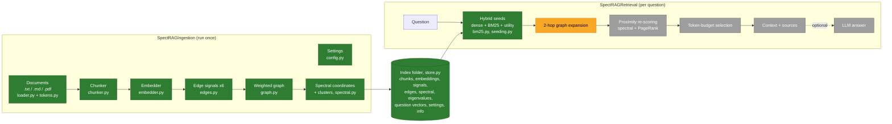
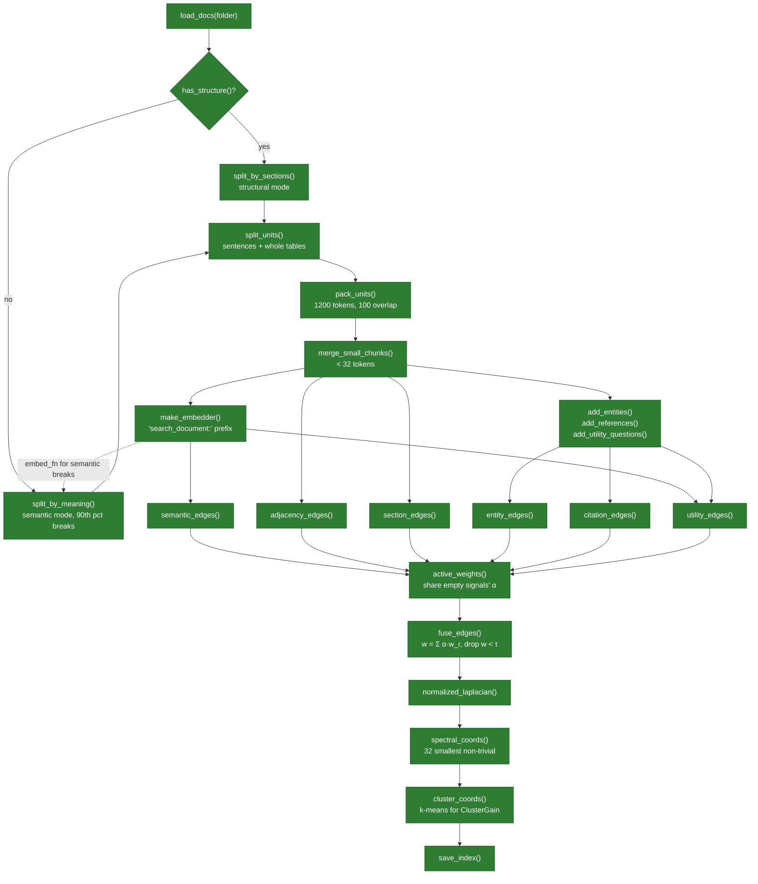
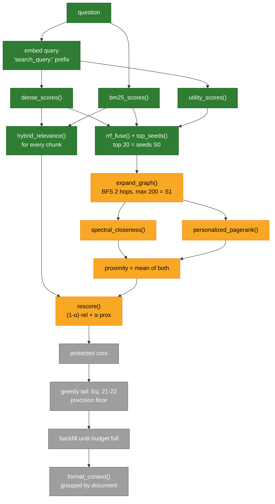
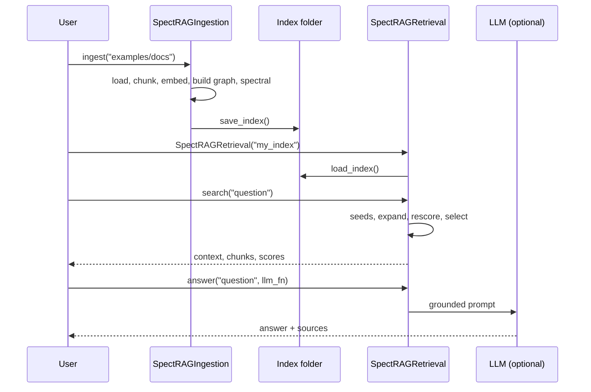
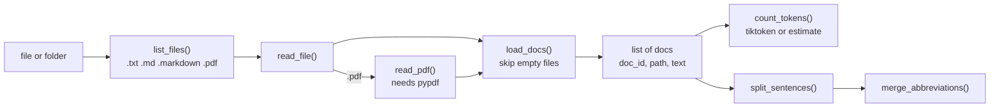
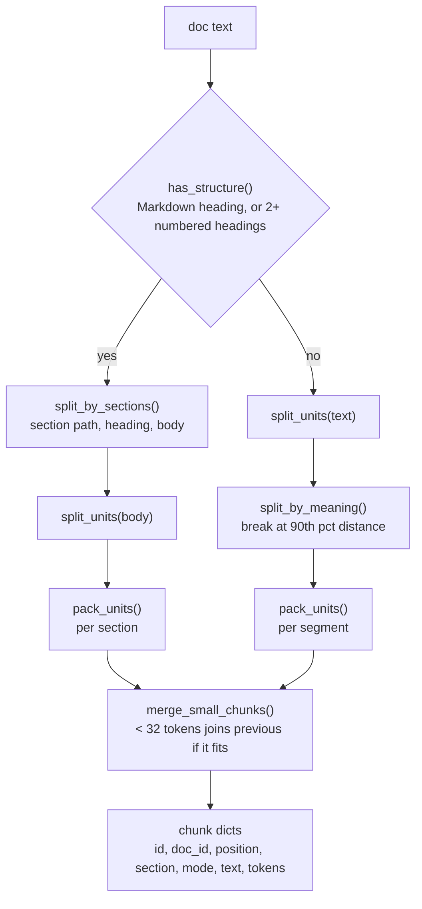
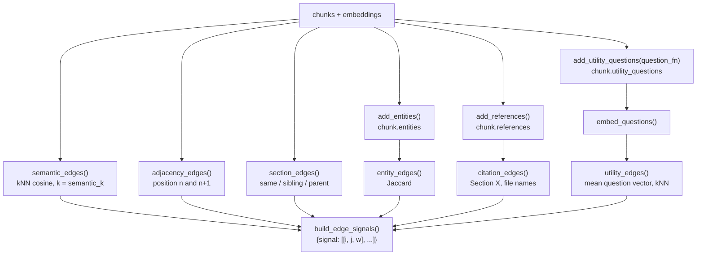
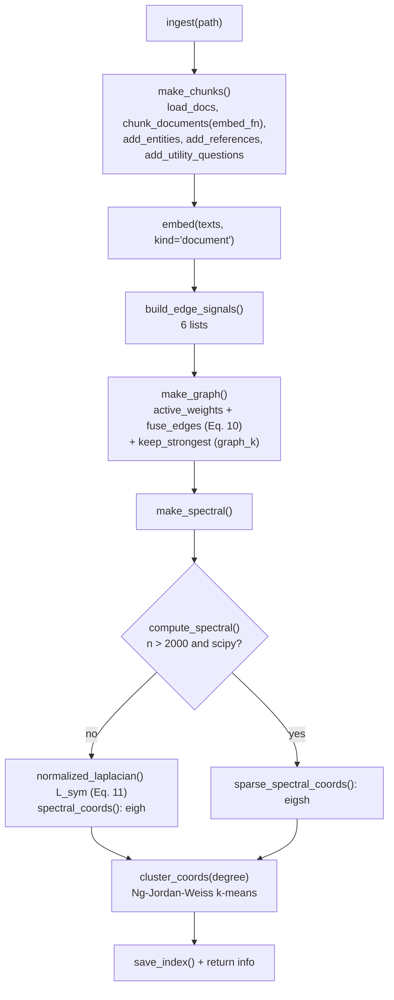
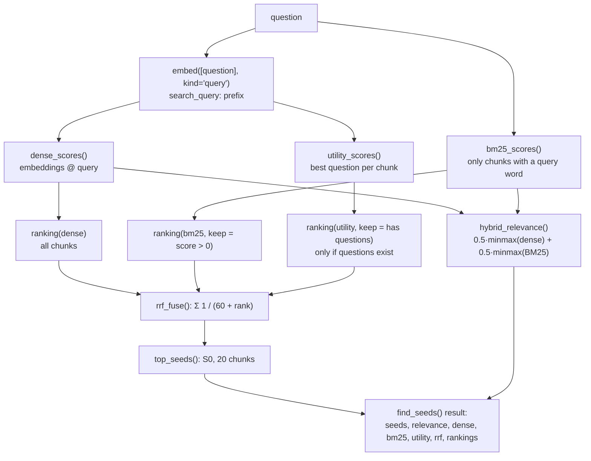

# SpectRAG — a small, readable Python implementation

SpectRAG is a retrieval method for RAG (Retrieval-Augmented Generation). It comes from the paper
**"SpectRAG: Weighted Chunk Graphs for Token-Budgeted Context Selection in Multi-Hop
Retrieval-Augmented Generation"** (Sahinoglu et al., arXiv:2610.36991v2), included at
[`docs/2610.36991v2.pdf`](docs/2610.36991v2.pdf).

This repository rebuilds the method as a **lightweight, beginner-friendly Python package**:
short files, small functions, `numpy` as the only required dependency, and tests for every phase.

> **Project status:** Phases 1–7 of 10 are done. **The offline half of SpectRAG works:**
> `SpectRAGIngestion` builds a complete index (chunks, embeddings, six edge signals, the fused
> weighted graph, spectral coordinates, and clusters). The first online stage, hybrid seed
> retrieval (dense + BM25 + utility questions, fused with RRF), works too. Graph expansion and
> re-scoring (Phase 8) are next; `SpectRAGRetrieval` is completed in Phase 9. See
> [Section 11](#11-implementation-phases-and-progress) for progress and
> [Section 15](#15-what-is-implemented-so-far) for the code that exists today.

---

## Table of contents

1. [SpectRAG in plain words](#1-spectrag-in-plain-words)
2. [Paper analysis](#2-paper-analysis)
3. [Architecture](#3-architecture)
4. [Ingestion flow (offline)](#4-ingestion-flow-offline)
5. [Retrieval flow (online)](#5-retrieval-flow-online)
6. [Execution flow](#6-execution-flow)
7. [Package folder structure](#7-package-folder-structure)
8. [Planned scripts and functions](#8-planned-scripts-and-functions)
9. [Settings: paper values and our defaults](#9-settings-paper-values-and-our-defaults)
10. [Assumptions and deviations from the paper](#10-assumptions-and-deviations-from-the-paper)
11. [Implementation phases and progress](#11-implementation-phases-and-progress)
12. [Installation and usage (planned)](#12-installation-and-usage-planned)
13. [Testing strategy](#13-testing-strategy)
14. [Known issues](#14-known-issues)
15. [What is implemented so far](#15-what-is-implemented-so-far)

---

## 1. SpectRAG in plain words

A normal RAG system splits documents into **chunks**, turns every chunk into a vector, and returns
the *top-k* chunks closest to the question. The paper names three problems with that:

| Problem | What goes wrong |
|---|---|
| **Redundancy** | Near-duplicate chunks sit close together in vector space, so top-k returns several copies of the same fact. |
| **Missing bridge evidence** | Multi-hop questions need "connector" chunks that are not similar to the question itself, so top-k skips them. |
| **Structure blindness** | Chunks are treated as unrelated, even though they share sections, entities, citations, and document order. |

SpectRAG treats retrieval as **picking a good *set* of chunks**, not a list of individually good chunks:

1. **Build a graph** where every chunk is a node. Edges join chunks that are related in any of six
   ways: similar meaning, next to each other, same section, shared names, one cites the other, or
   they answer similar questions.
2. **Compute "spectral coordinates"** from the graph's Laplacian matrix. Each chunk gets a small
   vector (32 numbers) that says *where it sits in the graph's communities*, not what it says.
3. At question time, **find seed chunks** using dense vectors + BM25 keywords + question matching.
4. **Walk the graph** two hops out from the seeds to collect connector chunks.
5. **Spread relevance** across the graph (PageRank-style), so connectors close to strong seeds
   score higher.
6. **Fill a token budget** (about 12k tokens): keep the best chunks, then add chunks that cover new
   communities and new documents and repeat little, until the budget is full.

---

## 2. Paper analysis

### 2.1 The core idea (Eq. 8–9)

The paper sets retrieval up as choosing a context set `C` that maximises

```
F(C, q) = Σ Rel(c, q)  −  λ Σ Red(ci, cj)  +  γ Cov(C, q)  +  η Conn(C; G)
          relevance       redundancy          coverage        graph connectivity
```

With `λ = γ = η = 0` this reduces to plain top-k. Picking the best set exactly is too slow, so
the paper approximates it with the pipeline below and a greedy selection rule (Eq. 21–22).

### 2.2 Offline pipeline (paper Table 1), run once per document collection

| Step | Paper | What it produces |
|---|---|---|
| Chunking | Structural (headings) or semantic (sentence-embedding breakpoints at the 90th percentile). `cl100k_base` tokens: 1200 per chunk, 100 overlap. Never cuts mid-sentence; chunks under 32 tokens merge into the previous one; tables are kept whole as Markdown. | Chunks with text, position, section path, references |
| Embedding | `nomic-embed-text` (768-d), `search_document:` prefix, L2-normalised, FAISS `IndexFlatIP` (exact search) | One vector per chunk |
| Edge signals | Six extractors (Eq. 10); entities and utility questions come from `gpt-4o-mini` | Six edge lists `(i, j, weight)` |
| Graph build | `w_ij = Σ α_r · w_r,ij`; drop edges with `w_ij < τ` | Weighted graph `G = (V, E, W)` |
| Spectral decomposition | `L_sym = I − D^-1/2 W D^-1/2` (Eq. 11); the 32 smallest non-trivial eigenvectors (Eq. 12–13) | 32-d spectral coordinates `z_i` per chunk |
| Neo4j write | Stores the graph in Neo4j | Persistent graph |
| Persist | `chunks.pkl` + `faiss.index` | Files on disk |

**The six edge signals (Section 3.2.1), each scaled to [0, 1]:**

| Signal | Meaning | Paper weight (config 1) | Paper weight (config 2) |
|---|---|---|---|
| Semantic | `max(0, cos(e_i, e_j))`, only for each node's `k_g` nearest neighbours | 0.300 | 0.150 |
| Hierarchy (section) | Same heading or parent section | 0.250 | 0.200 |
| Entity | Overlap in names, terms, organisations, dates | 0.200 | 0.250 |
| Adjacency | Consecutive chunks in the same document | 0.084 | 0.100 |
| Utility question | Similarity of LLM-generated "questions this chunk answers" | 0.083 | 0.280 |
| Citation | References, hyperlinks, footnotes, "see Section X" | 0.083 | 0.020 |

### 2.3 Online pipeline (paper Table 2 and Algorithm 1), run per question

| Stage | Paper | Output |
|---|---|---|
| 1. Hybrid seed retrieval | Reciprocal Rank Fusion (RRF) of dense cosine, BM25, and query-to-utility-question matching. The relevance passed downstream is hybrid (dense + BM25). | Seed set `S0` (20 chunks) and a relevance score for every chunk |
| 2. Graph expansion | Two-hop breadth-first search (BFS) from `S0`, capped at 200 nodes | Candidate set `S1` and its subgraph |
| 3. Proximity re-scoring | `s2 = (1 − α)·relevance + α·proximity`; proximity = mean of *spectral closeness* and *Personalized PageRank* from the seeds | Re-scored candidates `S2` |
| 4. Token-budget selection | About 12k tokens: protected core, tail precision floor, document-coverage tie-break, backfill (Eq. 19–22) | Final context `C`, usually 10–15 chunks |
| 5. Generation | Context grouped by source document; `gpt-4o-mini`, temperature 0, grounded prompt | Answer and ranked sources |

**Diffusion (Section 3.7).** The exact form is `s' = exp(−t·L_sym)·s` (Eq. 17). The paper's
practical version is the repeated smoothing in Eq. 18:
`s(r+1) = β·s + (1 − β)·Ã·s(r)` with `à = D^-1/2 A D^-1/2`. This is Personalized PageRank.

**Selection score (Eq. 21–22).** Each greedy step picks the candidate that maximises

```
U(c | C) = a·s_c + b·Prox(c, S0) + c·ClusterGain(c, C) + d·DocGain(c, C) − λ·Red(c, C)
pick  argmax  U(c | C) / tokens(c)^ρ          (ρ in [0, 1] sets how much length matters)
```

### 2.4 Main reported results (for context only; we do not reproduce the benchmarks)

- On MultiHopRAG: highest overall recall (91.8) and Recall@10 (84.0). Strong hybrid retrieval is
  still better on early precision (R@2, R@5, MRR).
- Answer accuracy is highest of the five systems, by a small margin (EM 71.2 vs 70.6). Gains are
  largest on *inference* questions.
- The graph has 2.8–6.6× fewer nodes than LightRAG, and the index is about 6× smaller (46 MB vs 274 MB).
- In LLM-judge comparisons, **diversity** is the most consistent win.

### 2.5 Inconsistencies found in the paper, and how we resolve them

| Where | Inconsistency | Our choice |
|---|---|---|
| Eq. 2 vs Eq. 10 | Eq. 2 lists 5 signals, Eq. 10 lists 6 | Use the 6 signals of Eq. 10 |
| Eq. 15 vs Table 2 / Alg. 1 | Eq. 15 seeds by dense similarity only; Table 2 uses RRF of three rankings | Follow Table 2 / Algorithm 1 (hybrid RRF) |
| Section 3.2.3 vs Table 1 | "Smallest *non-trivial*" vs "32 smallest" eigenvectors | Skip the trivial first eigenvector (Eq. 13: `u2 … u_{m+1}`) |
| Eq. 17 vs Table 2 | Heat-kernel diffusion vs Personalized PageRank | Use PPR (Eq. 18) as the default |
| Eq. 9 vs Eq. 21 | `Cov` and `Conn` in the objective vs `ClusterGain`, `DocGain`, `Prox` in the greedy rule | Implement Eq. 21–22, the rule the paper actually uses |
| Section 6 vs Table 8 | The text says SpectRAG is best on null questions; the table shows it is not | Does not affect the implementation |

---

## 3. Architecture

Two main classes share one index folder on disk:



Colours: green = done, yellow = in progress, grey = pending.

**Design rules**

- **Pluggable models.** Embedding, entity extraction, utility questions, and answer generation are
  plain Python functions you can swap. Defaults need no internet and no API key, so every test
  runs offline.
- **No database server.** The paper uses Neo4j and FAISS. We keep the graph as a Python dict and
  search with `numpy` dot products (the same exact math as `IndexFlatIP`).
- **Files you can read.** The index is JSON plus `.npy` files, so you can open and inspect it.

---

## 4. Ingestion flow (offline)



Note: in semantic mode, `split_units()` runs before `split_by_meaning()`, so tables stay whole there too.

---

## 5. Retrieval flow (online)



---

## 6. Execution flow

What happens when a user runs the package end to end:



---

## 7. Package folder structure

Planned layout (files are created phase by phase):

```
Spect-RAG/
├── README.md
├── pyproject.toml
├── docs/
│   └── 2610.36991v2.pdf            # the paper
├── examples/
│   ├── docs/                       # small sample documents
│   ├── ingest_example.py
│   └── search_example.py
├── src/
│   └── spectrag/
│       ├── __init__.py             # exports SpectRAGIngestion, SpectRAGRetrieval
│       ├── config.py               # default settings (paper values)
│       ├── ingestion.py            # class SpectRAGIngestion
│       ├── retrieval.py            # class SpectRAGRetrieval
│       └── utils/
│           ├── __init__.py
│           ├── loader.py           # read .txt/.md/.pdf files
│           ├── tokens.py           # count tokens, split sentences
│           ├── sections.py         # find headings, split by section
│           ├── units.py            # sentences + whole tables
│           ├── semantic_split.py   # semantic chunking
│           ├── chunker.py          # pack units into chunks
│           ├── embedder.py         # hashing embedder + Ollama nomic-embed-text
│           ├── entities.py         # simple entity extraction
│           ├── references.py       # "Section 2.1" and file-name references
│           ├── questions.py        # utility questions with any LLM (optional)
│           ├── edge_list.py        # add_edge / as_list helpers
│           ├── edges_structure.py  # adjacency, section, citation signals
│           ├── edges_content.py    # semantic, entity, utility signals
│           ├── edges.py            # build all six signals
│           ├── graph.py            # fuse weights, adjacency, neighbours
│           ├── spectral.py         # Laplacian, eigenvectors (dense or sparse)
│           ├── clusters.py         # spectral clusters (k-means)
│           ├── store.py            # save/load the index
│           ├── bm25.py             # BM25 keyword scoring
│           ├── seeding.py          # dense/BM25/utility scores + RRF
│           ├── expansion.py        # BFS graph expansion
│           ├── diffusion.py        # PageRank + spectral proximity + re-score
│           ├── selection.py        # token-budget context selection
│           └── prompt.py           # format context, optional answer
└── tests/
    ├── test_tokens.py
    ├── test_chunker.py
    └── ...                         # one test file per utils module
```

**Why `src/spectrag/utils/` rather than `src/utils/`:** a top-level package called `utils` would
clash with any other `utils` module once installed. Nesting it under `spectrag` keeps everything
inside `src/` and makes it importable as `spectrag.utils`.

---

## 8. Planned scripts and functions

Every function is meant to be about 5–20 lines and do one job.

| File | Main functions | Purpose |
|---|---|---|
| `config.py` | `DEFAULTS`, `make_settings(overrides)` | One dict of settings; users override only what they need |
| `utils/loader.py` | `load_docs(path)`, `read_file(path)` | Read a file or a folder into `{"doc_id", "text"}` dicts |
| `utils/tokens.py` | `count_tokens(text)`, `split_sentences(text)` | `tiktoken` when installed, otherwise a word-based estimate |
| `utils/sections.py` | `is_heading()`, `has_structure()`, `split_by_sections()` | Find headings and section paths |
| `utils/units.py` | `split_units()`, `split_table()` | Sentences and whole tables |
| `utils/semantic_split.py` | `split_by_meaning()`, `find_breakpoints()` | Break where sentence distance reaches the 90th percentile |
| `utils/chunker.py` | `pack_units()`, `take_overlap()`, `merge_small_chunks()`, `chunk_documents()` | Chunks with size limit and overlap |
| `utils/embedder.py` | `make_embedder()`, `hash_embed()`, `ollama_embed()`, `normalize()` | Offline default embedder; optional real `nomic-embed-text`; or your own function |
| `utils/entities.py` | `extract_entities(text)`, `add_entities(chunks)` | Capitalised phrases and their words, years (regex) |
| `utils/references.py` | `extract_references(text)`, `add_references(chunks)` | Section numbers and file names a chunk refers to |
| `utils/questions.py` | `make_question_fn(llm_fn)`, `add_utility_questions()`, `ollama_llm()` | Optional LLM-generated utility questions |
| `utils/edges_structure.py` | `adjacency_edges()`, `section_edges()`, `citation_edges()` | Structure signals |
| `utils/edges_content.py` | `semantic_edges()`, `entity_edges()`, `utility_edges()`, `knn_edges()` | Content signals |
| `utils/edges.py` | `build_edge_signals()` | Six lists of `[i, j, weight]` |
| `utils/graph.py` | `active_weights()`, `fuse_edges()`, `build_matrix()`, `neighbors()`, `degrees()` | Weighted sum, threshold `τ`, adjacency matrix |
| `utils/spectral.py` | `normalized_laplacian()`, `spectral_coords()`, `sparse_spectral_coords()`, `compute_spectral()` | Eq. 11–13 |
| `utils/clusters.py` | `cluster_coords()`, `kmeans()` | Spectral clusters for ClusterGain |
| `utils/store.py` | `save_index()`, `load_index()` | Any dict → `.npy` (arrays) and `.json` (everything else) |
| `utils/bm25.py` | `build_bm25()`, `bm25_scores()` | Classic BM25 in pure Python |
| `utils/seeding.py` | `find_seeds()`, `dense_scores()`, `utility_scores()`, `rrf_fuse()`, `hybrid_relevance()` | Online stage 1 |
| `utils/expansion.py` | `expand_graph()` | Online stage 2 |
| `utils/diffusion.py` | `personalized_pagerank()`, `spectral_closeness()`, `rescore()` | Online stage 3 (Eq. 18) |
| `utils/selection.py` | `select_context()`, `pick_core()`, `utility_gain()`, `backfill()` | Online stage 4 (Eq. 19–22) |
| `utils/prompt.py` | `format_context()`, `build_prompt()` | Group by document; build the grounded prompt |
| `ingestion.py` | `SpectRAGIngestion.ingest(path)` | Runs the whole offline pipeline |
| `retrieval.py` | `SpectRAGRetrieval.search(q)`, `.answer(q, llm_fn)` | Runs the whole online pipeline |

---

## 9. Settings: paper values and our defaults

✅ = stated in the paper. ⚠️ = not stated in the paper, so we chose a value (all can be changed).

| Setting | Default | Source |
|---|---|---|
| `chunk_tokens` / `overlap_tokens` | 1200 / 100 (alt. 256 / 64) | ✅ |
| `min_chunk_tokens` | 32 | ✅ |
| `semantic_percentile` | 90 | ✅ |
| `embedder` | `"hash"` (offline). `"ollama"` = the paper's model, or pass your own function | D3 |
| `embed_dims` | 768 (size of the hash vectors; matches `nomic-embed-text`) | ✅ |
| `ollama_model` / `ollama_url` | `nomic-embed-text` / `http://localhost:11434` | ✅ / ⚠️ |
| `edge_weights` | config 1: sem .300, sec .250, ent .200, adj .084, utl .083, cit .083 | ✅ |
| `spectral_dims` (m) | 32 (capped at n − 1 for small corpora) | ✅ |
| `seed_count` | 20 | ✅ |
| `hops` / `max_candidates` | 2 / 200 | ✅ |
| `token_budget` | 12000 | ✅ |
| `semantic_k` (k_g) | 10 | ⚠️ |
| `edge_threshold` (τ) | 0.05 | ⚠️ |
| `graph_k` | 10: each chunk keeps at most its 10 strongest graph edges (D35) | ⚠️ |
| `rrf_k` | 60 (the usual RRF constant) | ⚠️ |
| `bm25_k1` / `bm25_b` | 1.5 / 0.75 (the usual BM25 values) | ⚠️ |
| `bm25_weight` | 0.5: hybrid relevance = 0.5 · dense + 0.5 · BM25 (each rescaled to 0..1) | ⚠️ |
| `alpha` (re-score blend) | 0.3 | ⚠️ |
| `ppr_beta` / `ppr_steps` | 0.15 / 30 | ⚠️ |
| `core_size` (protected core) | 3 | ⚠️ |
| `precision_floor` | 0.4 × best score | ⚠️ |
| Eq. 21 weights `a, b, c, d, λ` | 1.0, 0.3, 0.2, 0.1, 0.5 | ⚠️ |
| `length_power` (ρ) | 0.5 | ⚠️ |
| `n_clusters` | `None` = `round(sqrt(n / 2))`, at least 2 (at most n) | ⚠️ |

---

## 10. Assumptions and deviations from the paper

| # | Paper | This implementation | Why |
|---|---|---|---|
| D1 | Neo4j graph database | In-memory Python dict, saved as JSON | No server needed; BFS over a dict is easy to follow |
| D2 | FAISS `IndexFlatIP` | `numpy` dot product on normalised vectors | Same exact result with no extra dependency |
| D3 | `nomic-embed-text` | Default: offline hashing embedder (words + word pairs, md5-hashed into 768 slots with ±1 signs). Optional: real `nomic-embed-text` through Ollama (`urllib`, no new package), with the `search_document:` / `search_query:` prefixes. Or any function `texts -> vectors` | Tests run offline and fast; the real model stays available |
| D4 | `gpt-4o-mini` entity extraction | Default: regex extractor (capitalised phrases and their words, years; single words that start a sentence are skipped). Optional: pass your own `entity_fn` | No API key needed |
| D5 | `gpt-4o-mini` utility questions | Default: **off** (its weight is shared among the other signals). Optional: `make_question_fn(llm_fn)` with any LLM, e.g. `ollama_llm("gemma3:4b")` | Avoids any LLM requirement |
| D6 | Generation with `gpt-4o-mini` | `search()` returns the context; `answer()` takes any `llm_fn(prompt)` | Works with any LLM provider |
| D7 | `cl100k_base` tokenizer | `tiktoken` if installed, else about 0.75 words per token | `tiktoken` stays optional |
| D8 | PDF table extraction | Markdown tables are kept whole; PDF text read with optional `pypdf` | Reliable PDF table parsing is out of scope |
| D9 | Auto-calibrated edge weights | Fixed priors only (config 1 or 2) | The paper does not describe the calibration method |
| D10 | Heat-kernel diffusion `exp(−tL)` | PPR iteration (Eq. 18) by default | The paper names PPR in Table 2 and Algorithm 1 |
| D11 | "Spectral eigenspace closeness" (not defined) | Cosine between a candidate's `z` and the relevance-weighted centre of the seeds' `z`, mapped to [0, 1] | Simplest reading of the term |
| D12 | ClusterGain needs spectral clusters (method not given) | Normalised spectral clustering (Ng–Jordan–Weiss, as in von Luxburg [5]): for k clusters, take the trivial eigenvector (`√degree`, rebuilt from the degrees) plus the first k − 1 non-trivial coordinates, i.e. the k smoothest eigenvectors; scale rows to length 1; k-means. Start centres chosen far apart, so no randomness | Using all 32 coordinates mixes in high-frequency eigenvectors and hides communities (seen on the sample docs). Leaving out the trivial vector makes chunks near `u2 = 0` fall to a random side |
| D13 | Isolated nodes (degree 0) make `D^-1/2` undefined | Use 0 for those entries (their row of `L_sym` is the identity row) | Keeps the Laplacian well defined |
| D14 | Alternative selectors (`mmr`, `protected_mmr`, `anchor_expand_ce`) | Not implemented; only the default selector | Not described in enough detail |
| D15 | Benchmarks (MultiHopRAG, UltraDomain), LLM judge | Not reproduced; we include Recall@k, MRR, EM, F1 helpers and a toy evaluation | Needs datasets and paid APIs |
| D16 | 100-token overlap "as a suffix of the previous chunk" | Overlap only between chunks of the **same** section or semantic segment; no overlap across a heading or topic break | Overlap across sections would put one section's text under another's section path |
| D17 | Semantic breaks use `nomic-embed-text` sentence vectors | `split_by_meaning()` accepts any `embed_fn`; without one it uses word-count cosine. Ties at the percentile count as breaks unless all distances are equal | Phase 3 comes before the embedder; word overlap often gives many distances of exactly 1.0 |
| D18 | Chunks < 32 tokens are concatenated with the previous chunk | Merged only if the result stays within `chunk_tokens`, so a small chunk can survive when chunks are tiny (e.g. 60) | The maximum chunk size is treated as the harder limit |
| D19 | Overlap always present | Dropped for the next chunk when overlap + the next unit would go over the limit | Keeps every chunk within `chunk_tokens` |
| D20 | Section headings | The heading line is kept as the first line of its section's first chunk. A heading with no body text of its own (e.g. `## 2. Products`) is carried forward and put in front of the next section's heading; headings at the very end are added to the last section. In Markdown files only `#` headings count, so numbered lists (`1. Install`) stay normal text | No line is ever lost, there are no empty chunks, and heading words stay searchable |
| D21 | Numbered headings | A line like `2.1 Datasets` counts as a heading only if it starts with a capital letter after the number, has ≤ 10 words, and does not end in `.`, `:`, `,` or `;` | Avoids treating numbered list items as headings |
| D22 | FAISS `IndexFlatIP` file | Vectors saved as `embeddings.npy` (float32, L2-normalised); search is `embeddings @ query` | Same exact scores, one fewer dependency |
| D23 | `chunks.pkl` (pickle) | `chunks.json` (readable), loaded with `np.load(allow_pickle=False)` for arrays | Readable files, and loading an index never runs pickled code |
| D24 | Prefixes for the hash embedder | Not added: prefix words would only add noise to word-hash vectors | Prefixes are an instruction for `nomic-embed-text` only |
| D25 | Entity weight "overlap in named entities" (no formula) | Jaccard: shared ÷ all entities of the two chunks; only for pairs sharing ≥ 1 entity | Standard, in [0, 1], and does not over-reward chunks with many entities |
| D26 | Hierarchy weight "shared headings or a common parent section" (no formula) | Same section = 1.0; siblings or parent–child = shared prefix ÷ longer path (e.g. 2.1 vs 2.2 = 2/3); more distant = no edge; never across documents | Graded by depth, and restricting to direct relatives keeps the graph sparse |
| D27 | Citation edges: "references, hyperlinks, footnotes" | Two kinds: `Section 2.1` / `Sec. 3` / `§4` → chunks of that section in the same document; file names (`notes.md`, Markdown links) → every chunk of that document; weight 1.0 | Footnote and bibliography links are too ambiguous without layout information |
| D28 | Utility edges: "similarity between generated questions" | Each chunk's question vectors are averaged, then linked to its `semantic_k` nearest neighbours by cosine. Per-question vectors are kept for query-time matching (Phase 7) | A full question × question matrix grows too fast; averaging keeps it `O(n²)` in chunks |
| D29 | Question vectors | Embedded as `kind="document"` (prefix `search_document:`) | At query time the user's question is the `search_query:` side |
| D30 | Utility weight when no LLM is used | A signal with **no edges** gets weight 0, and the other weights are rescaled to sum to 1 (`active_weights()`) | Otherwise 8.3% of the weight would be lost and every fused edge would be weaker against `τ` |
| D31 | Neo4j write with per-signal attributes | `signals.json` keeps every signal's own edge list; `edges.json` holds the fused graph | Same information, readable without a database |
| D32 | Eigen-solver | `numpy.linalg.eigh` on the dense `n × n` Laplacian | Exact and simple; fine for thousands of chunks |
| D33 | Small corpora | `spectral_dims` is capped at `n − 1` (the number of non-trivial eigenvectors) | A graph with `n` nodes has only `n − 1` of them |
| D34 | "Never cuts mid-sentence" | A single "sentence" longer than a whole chunk (common in PDF text without full stops) is cut between words, as a last resort, with exact token checks | Later phases fill a token budget, so every chunk must really be ≤ `chunk_tokens` |
| D35 | Sparse graph, `\|E\| = O(k_g n)` (Section 3.2.2), Table 4 shows 0.8–5.7 edges per node | After `τ`, each chunk keeps at most its `graph_k = 10` strongest edges (an edge survives if it is in the top 10 of either end). Adjacency edges are always kept, so each document stays one connected chain | Without this, long sections (all pairs weight 1.0) and common entities gave 144 edges per chunk on a 3,465-chunk test; with it, about 7 |
| D36 | Entity edges | An entity in more than 5% of the chunks (and more than 20 chunks) adds no entity edges | It does not tell chunks apart (like a stopword), and counting its pairs is `O(df²)`. Small corpora are never affected |
| D37 | Large graphs | Above 2,000 chunks, if `scipy` is installed, eigenvectors come from `scipy.sparse.linalg.eigsh` on `D^-1/2 W D^-1/2` (its largest eigenvalues are `1 −` the smallest of `L_sym`) with a fixed start vector | The paper suggests approximate eigensolvers for scale (Section 7); results match the dense solver (tested) |
| D38 | BM25 settings and tokenizer (not given) | Lowercase `\w+` words, no stemming and no stopword list; `k1 = 1.5`, `b = 0.75`; Lucene-style `idf = ln(1 + (N − df + 0.5) / (df + 0.5))` | Standard choices; this IDF is never negative, so common words cannot push scores down |
| D39 | RRF lists | Dense ranks **all** chunks; BM25 ranks only chunks that contain a query word; utility ranks only chunks that have questions, and is left out when there are none. RRF constant `k = 60`, ranks start at 1 | A chunk with zero keyword overlap was not "retrieved" by BM25, so it should not earn BM25 RRF credit |
| D40 | Utility matching "query to stored questions" | A chunk's utility score is the **best** cosine between the query and any of its questions | One matching question is enough to show the chunk answers the query |
| D41 | "The full relevance vector … is hybrid (dense & BM25)" (Table 2), no formula | `relevance = (1 − w)·minmax(dense) + w·minmax(BM25)` with `w = bm25_weight = 0.5`, over all chunks | Puts both on the same 0..1 scale before mixing; the weight can be changed |
| D42 | FAISS exact search for dense seeds and utility questions (Section 6.2) | `embeddings @ query` and `question_vectors @ query` in `numpy` | Exactly the same result as `IndexFlatIP` |

---

## 11. Implementation phases and progress


Legend: 🟩 done · 🟨 in progress · ⬜ pending

| Phase | Scope | Testable result | Status |
|---|---|---|---|
| 1 | Paper analysis, architecture, plan, diagrams | This README | 🟩 Done |
| 2 | `pyproject.toml`, `config.py`, `loader.py`, `tokens.py`, sample docs | Load sample docs, count tokens, split sentences | 🟩 Done (18 tests) |
| 3 | `sections.py`, `units.py`, `semantic_split.py`, `chunker.py` | Chunks respect size, overlap, sentences, tables | 🟩 Done (44 tests in total) |
| 4 | `embedder.py`, `store.py` | Vectors are normalised; save/load gives the same data back | 🟩 Done (57 tests in total) |
| 5 | `entities.py`, `references.py`, `questions.py`, `edge_list.py`, `edges_structure.py`, `edges_content.py`, `edges.py` | Each signal finds the expected links on a toy corpus | 🟩 Done (81 tests + 1 opt-in) |
| 6 | `graph.py`, `spectral.py`, `ingestion.py` | `SpectRAGIngestion().ingest()` writes a full index | 🟩 Done (98 tests + 1 opt-in) |
| 7 | `bm25.py`, `seeding.py` | Seeds contain the obvious matching chunks | 🟩 Done (128 tests + 1 opt-in) |
| 8 | `expansion.py`, `diffusion.py` | Bridge chunks gain score through the graph | 🟨 Next |
| 9 | `selection.py`, `prompt.py`, `retrieval.py` | `search()` respects the budget and diversifies documents | ⬜ Pending |
| 10 | `answer()`, metrics, examples, final README | End-to-end demo plus SpectRAG vs top-k on a toy multi-hop set | ⬜ Pending |

---

## 12. Installation and usage

Installation works now, with either `pip` or `uv`:

```bash
git clone <your-repo-url> && cd Spect-RAG

# Option A: pip
python3 -m venv .venv && source .venv/bin/activate
pip install -e .              # installs numpy
pip install -e ".[dev]"       # adds pytest
pip install -e ".[extras]"    # optional: tiktoken (exact token counts), pypdf (PDF files),
                              #           scipy (fast eigenvectors for > 2,000 chunks)

# Option B: uv (installs everything, including the optional extras)
uv sync --all-extras
```

With `uv`, put `uv run --all-extras` in front of each command below (e.g.
`uv run --all-extras pytest -q`). A plain `uv sync` removes the extras, including `pytest`.

Runnable now (Phase 2 demo):

```bash
python examples/load_example.py
```

Expected output with `tiktoken` installed:

```text
Chunk size setting: 256 tokens
Token counter: tiktoken cl100k_base

aurora_labs.md
  tokens: 315  sentences: 24
  first sentence: # Aurora Labs
helios_energy.txt
  tokens: 162  sentences: 10
  first sentence: Helios Energy is a solar power company based in Porto.
river_valley_farming.md
  tokens: 143  sentences: 12
  first sentence: # River Valley Cooperative
```

Without `tiktoken`, the counter line says `word estimate`, and the token counts are 280, 164, and 145.

Runnable now (Phase 3 demo):

```bash
python examples/chunk_example.py           # paper default: 1200 tokens, 100 overlap
python examples/chunk_example.py 60 20     # tiny chunks, to see packing and overlap
```

Expected output with the default settings and `tiktoken` (shortened):

```text
chunk_tokens = 1200  overlap_tokens = 100
8 chunks

[0] aurora_labs.md #0  structural  113 tokens
    section: Aurora Labs > 1. History
    starts : # Aurora Labs
[1] aurora_labs.md #1  structural  53 tokens
    section: Aurora Labs > 2. Products > 2.1 Sensors
    starts : ## 2. Products
...
[4] helios_energy.txt #0  semantic  45 tokens
    section: (no headings)
    starts : Helios Energy is a solar power company based in Porto.
[5] helios_energy.txt #1  semantic  111 tokens
...
[7] river_valley_farming.md #1  structural  85 tokens
    section: River Valley Cooperative > Irrigation
    starts : ## Irrigation
```

What this shows:

- The Markdown files use **structural** mode and keep their section path. `# Aurora Labs` and
  `## 2. Products` have no body text of their own, so they are carried to the start of the next
  section's chunk (`# Aurora Labs` / `## 1. History` ...). No line of a document is ever lost.
- `helios_energy.txt` has no headings, so it uses **semantic** mode and breaks where the topic
  changes.
- The 3-row product table stays inside chunk 2.
- `## Plans` (about 30 tokens) is under the 32-token minimum, so it was merged into the
  "Irrigation" chunk.

With `60 20` you get 13 chunks, all ≤ 60 tokens. Long sections are split across several chunks,
and each next chunk starts with the last sentence(s) of the previous one.

Runnable now (Phase 5 demo):

```bash
python examples/edges_example.py                    # offline: hash embedder, no utility questions
python examples/edges_example.py ollama gemma3:4b   # nomic-embed-text + LLM utility questions
```

Actual output (offline, shortened):

```text
[2] aurora_labs.md#2           refs=['2.1']
     entities: 2017, 2018, 2020, aurora, aurora s1, aurora s2, dashboard, fieldview
[3] aurora_labs.md#3           refs=['river_valley_farming.md']
...
Edges per signal: {'semantic': 16, 'adjacency': 5, 'section': 3, 'entity': 14, 'utility': 0, 'citation': 3}

section
  0.500  aurora_labs.md#0 -- aurora_labs.md#3
  0.667  aurora_labs.md#1 -- aurora_labs.md#2
entity
  0.280  aurora_labs.md#0 -- helios_energy.txt#0      <- bridge: both mention Maya Chen
citation
  1.000  aurora_labs.md#1 -- aurora_labs.md#2          <- "described in Section 2.1"
  1.000  aurora_labs.md#3 -- river_valley_farming.md#0 <- "See river_valley_farming.md"
```

With `ollama gemma3:4b`, every chunk also gets 3 questions, for example *"Who was hired as chief
technology officer in 2019?"* for the Helios chunk, and the utility signal adds 16 edges.

Runnable now (Phase 6: the offline pipeline):

```python
from spectrag import SpectRAGIngestion

ingest = SpectRAGIngestion("my_index")              # offline hash embedder, no LLM
info = ingest.ingest("examples/docs")               # a file or a folder
print(info["chunks"], info["graph_edges"], info["clusters"])

# Real embeddings, your own settings, and optional LLM-based helpers:
from spectrag.utils.questions import make_question_fn, ollama_llm
ingest = SpectRAGIngestion("my_index",
                           settings={"embedder": "ollama", "chunk_tokens": 256,
                                     "overlap_tokens": 64},
                           question_fn=make_question_fn(ollama_llm("gemma3:4b")),
                           entity_fn=None)          # None = regex entity extractor
ingest.ingest("path/to/your/docs")
```

```bash
python examples/ingest_example.py                    # offline
python examples/ingest_example.py ollama             # nomic-embed-text
python examples/ingest_example.py ollama gemma3:4b   # + LLM utility questions
```

Actual output (offline, shortened). `n_clusters` is set to 3 in the demo:

```text
 "chunks": 8,
 "signal_edges": {"semantic": 28, "adjacency": 5, "section": 3, "entity": 14, "utility": 0, "citation": 3},
 "graph_edges": 21,
 "weights_used": {"semantic": 0.3272, "section": 0.2726, "entity": 0.2181,
                  "adjacency": 0.0916, "utility": 0.0, "citation": 0.0905},
 "spectral_dims": 7,
 "clusters": 3

Files: chunks.json, edges.json, eigenvalues.npy, embeddings.npy, info.json, question_owners.json,
       question_vectors.npy, settings.json, signals.json, spectral.npy
Smallest non-trivial eigenvalues: [0.512, 0.684, 1.059, 1.291]

Chunk  cluster  spectral u2   section / start
[0]    0       +0.198      aurora_labs.md: 1. History
[1]    2       -0.324      aurora_labs.md: 2.1 Sensors
[2]    2       -0.378      aurora_labs.md: 2.2 Software
[3]    1       -0.029      aurora_labs.md: 3. Partnerships
[4]    0       +0.573      helios_energy.txt: Helios Energy is a solar power
[5]    0       +0.598      helios_energy.txt: It predicts how much energy a
[6]    1       -0.025      river_valley_farming.md: Members
[7]    1       -0.159      river_valley_farming.md: Irrigation
```

What this shows:

- **Utility had no edges** (no LLM), so its 0.083 weight was shared among the other five, which
  again sum to 1.
- **The clusters are communities across documents**, not one cluster per document:
  - cluster 0 = Aurora's history + Helios, the Maya Chen story;
  - cluster 2 = Aurora's two product sections;
  - cluster 1 = Aurora's partnerships + River Valley, the supply relationship.

  `nomic-embed-text` gives the same three clusters.
- The first spectral coordinate `u2` (the Fiedler vector) places Helios at one end (+0.6) and the
  product sections at the other (−0.35). That is position in the graph, not text similarity
  (paper Fig. 4).

Runnable now (Phase 7: hybrid seed retrieval, the first online stage):

```python
from spectrag import make_settings
from spectrag.utils.bm25 import build_bm25
from spectrag.utils.embedder import make_embedder
from spectrag.utils.seeding import find_seeds
from spectrag.utils.store import load_index

index = load_index("my_index")
settings = make_settings(index["settings"])          # same embedder as at ingestion
embed = make_embedder(settings)
bm25 = build_bm25([c["text"] for c in index["chunks"]])   # built once, fast

question = "Which company did the co-founder of Aurora Labs join after leaving?"
result = find_seeds(question, embed([question], kind="query")[0], index, bm25, settings)
print(result["seeds"])        # S0: up to seed_count (20) chunk ids
print(result["relevance"])    # hybrid relevance for every chunk (0..1), used in Phases 8-9
```

```bash
python examples/seed_example.py                    # offline
python examples/seed_example.py ollama             # nomic-embed-text
python examples/seed_example.py ollama gemma3:4b   # + LLM utility questions
```

Actual output (the demo uses `seed_count = 4` so the lists are short; the paper uses 20):

```text
===== hash
Q: Which company did the co-founder of Aurora Labs join after leaving?
  dense    0:aurora_labs#0, 7:river_valley_farming#1, 2:aurora_labs#2, 3:aurora_labs#3
  bm25     0:aurora_labs#0, 3:aurora_labs#3, 6:river_valley_farming#0, 2:aurora_labs#2
  SEEDS    0:aurora_labs#0, 3:aurora_labs#3, 2:aurora_labs#2, 7:river_valley_farming#1
  relevance top 3: 0:aurora_labs#0=1.00, 3:aurora_labs#3=0.60, 2:aurora_labs#2=0.56
===== ollama + gemma3:4b questions
Q: Which company did the co-founder of Aurora Labs join after leaving?
  dense    0:aurora_labs#0, 3:aurora_labs#3, 1:aurora_labs#1, 7:river_valley_farming#1
  bm25     0:aurora_labs#0, 3:aurora_labs#3, 6:river_valley_farming#0, 2:aurora_labs#2
  utility  0:aurora_labs#0, 1:aurora_labs#1, 4:helios_energy#0, 5:helios_energy#1
  SEEDS    0:aurora_labs#0, 3:aurora_labs#3, 1:aurora_labs#1, 6:river_valley_farming#0
```

What this shows:

- Every ranking finds the direct match, chunk 0 (*"Maya Chen left Aurora Labs. She later joined
  Helios Energy"*).
- **The Helios chunks (4, 5) are missing** from the dense and BM25 top 4, even though they hold
  the rest of the answer (her role there). This is the "missing bridge evidence" problem from
  paper Section 1.2.
- With LLM utility questions, the utility ranking already pulls Helios up to places 3–4: matching
  on function, not wording. They still miss the 4 seeds. Phase 8 recovers such chunks by walking
  the graph from the seeds (the entity edge 0 ↔ 4 "Maya Chen").

Planned API for the rest of the online half (Phases 8–9):

```python
from spectrag import SpectRAGRetrieval

# Online: run per question
search = SpectRAGRetrieval(index_dir="my_index")
result = search.search("Which company did the founder of X later join?")
print(result["context"])          # text for your LLM, grouped by document
for chunk in result["chunks"]:    # selected chunks with scores
    print(chunk["doc_id"], chunk["score"])

# Optional: generate an answer with any LLM function
answer = search.answer("...", llm_fn=my_llm)
```

To use the real `nomic-embed-text` model (optional), install [Ollama](https://ollama.com), run
`ollama pull nomic-embed-text`, and use `make_settings({"embedder": "ollama"})`.

Runnable now (Phase 4 demo):

```bash
python examples/embed_example.py           # offline hash embedder
python examples/embed_example.py ollama    # real nomic-embed-text (needs Ollama running)
```

The demo chunks the sample docs, embeds them, saves `examples/demo_index/` (`chunks.json`,
`embeddings.npy`, `settings.json`; git ignores it), loads it back, and runs a plain dense search.
Actual output:

```text
--- hash ---
Saved 8 chunks, embeddings (8, 768) to demo_index

Question: Who is the chief technology officer of Helios Energy?
  1. score 0.255  [4] helios_energy.txt  Helios Energy is a solar power company based in Po
  2. score 0.198  [0] aurora_labs.md  ## 1. History
  3. score 0.134  [7] river_valley_farming.md  ## Irrigation
--- ollama ---
Saved 8 chunks, embeddings (8, 768) to demo_index

Question: Who is the chief technology officer of Helios Energy?
  1. score 0.781  [5] helios_energy.txt  In 2019 Helios Energy hired Maya Chen as chief tec
  2. score 0.746  [4] helios_energy.txt  Helios Energy is a solar power company based in Po
  3. score 0.672  [0] aurora_labs.md  ## 1. History
```

The hash embedder matches shared *words*, so it ranks Helios's intro chunk first. `nomic-embed-text`
matches *meaning*, so it finds the exact answer chunk. The real embedder also moves the semantic
break in `helios_energy.txt` (chunk 5 now starts at "In 2019 Helios Energy hired..."), because
chunking receives it as `embed_fn`.

---

## 13. Testing strategy

- **Unit tests** (`pytest`): one test file per `utils` module, using tiny hand-written texts with
  known answers.
- **Integration tests**: from Phase 6, ingest `examples/docs` into a temporary folder; from
  Phase 9, run `search()` on it.
- **Offline by default**: no test needs the internet, an API key, or Ollama. Ollama calls are
  tested with a fake server. One live test, `test_real_nomic_embed_text`, runs only when Ollama
  is reachable on `localhost:11434`; otherwise it is skipped.
- **Opt-in LLM test**: `SPECTRAG_LIVE_LLM=1 pytest tests/test_questions.py` calls a real Ollama
  LLM (default `gemma3:4b`; change it with `SPECTRAG_LLM_MODEL=qwen3:4b`).
- Run all tests: `pytest -q`. Run one file: `pytest tests/test_seeding.py -q`. See skipped tests
  with `pytest -q -rs`.

---

## 14. Known issues

- `split_sentences()` is rule-based. It handles common abbreviations (`Dr.`, `e.g.`, `Fig.`) and
  decimals (`2.1`), but an unusual abbreviation followed by a capital letter can still cause a
  wrong split.
- Without an `embed_fn`, semantic chunking measures sentence distance by word overlap, so its
  topic breaks are rough. Pass `embed_fn=make_embedder(settings)` (done automatically from
  Phase 6) to use the chosen embedder.
- `nomic-embed-text` has a 2048-token context in Ollama. Chunks are at most 1200 tokens, so they
  fit, but very long single sentences may be cut off by the model.
- The Ollama embedder makes one HTTP request per 32 texts and has no retry. A large corpus on a
  slow machine can take a while.
- With very small `chunk_tokens` (e.g. 60), a chunk can stay under the 32-token minimum when
  merging it would break the maximum (see D18).
- A single sentence longer than `chunk_tokens` becomes its own over-size chunk, because chunks
  never cut a sentence.
- Only Markdown pipe tables (`| a | b |`) are recognised as tables. Tables from PDFs come out as
  plain text.
- The regex entity extractor misses lowercase technical terms (e.g. "soil moisture") and picks up
  table header words (`product`, `year`). Pass an LLM-based `entity_fn` for better entities.
- Semantic edge weights depend on the embedder: `nomic-embed-text` cosines are usually 0.6–0.9,
  hash cosines 0.1–0.4. The edge threshold `τ` (Phase 6) therefore removes different edges for
  each embedder.
- With few chunks, `semantic_k = 10` links almost every pair. The demo uses `semantic_k = 3`.
- `section_edges()` and `knn_edges()` compare all pairs (`O(n²)`), and `entity_edges()` links
  every pair that shares a common entity. Fine for thousands of chunks, slow for millions.
- Citation edges to a file link to every chunk of that file, which can add many edges for a
  large target document.
- With `tiktoken` installed, the first call to `count_tokens()` may download the `cl100k_base`
  file. If that fails (for example, offline), the counter silently falls back to the word estimate.
- PDF text comes from `pypdf`'s `extract_text()`, so layout such as columns and tables can come
  out jumbled.
- The hashing embedder captures word overlap, not meaning (see the Phase 4 demo). Use Ollama
  `nomic-embed-text` for real semantic quality. Hash collisions between different words are rare
  at 768 dimensions but possible.
- When `semantic_k` is close to the number of chunks, the semantic signal links almost every
  pair, the graph is nearly complete, and the eigenvalues bunch up near 1 (weak community
  structure). With `nomic-embed-text` on the 8 sample chunks, 28 of 28 possible edges survive
  `τ`. Use a smaller `semantic_k` or a higher `edge_threshold` for tiny corpora. On real corpora
  (hundreds of chunks or more), `k = 10` is sparse.
- `edge_threshold` (`τ` = 0.05) is a guess, and its effect depends on the embedder (see the
  Phase 5 note on cosine ranges).
- Auto-calibration of the edge weights per corpus (paper Section 3.2.2) is not implemented (D9).
- The k-means start (farthest point from chunk 0) is deterministic but not always the best
  clustering. Re-running gives the same result.
- Eigenvectors have an arbitrary sign (`u` and `−u` are both valid). Phase 8 only compares
  coordinates *between* chunks, so this does not matter, but the sign printed in the demo can flip
  if the graph changes.
- Without `scipy`, the dense eigen-decomposition (`numpy.linalg.eigh`) is `O(n³)` in time and
  `n²` in memory. That is fine up to a few thousand chunks. Install the extras (`scipy`) for
  larger corpora; the sparse solver is used automatically above 2,000 chunks (D37).
- `semantic_edges()` still compares every chunk with every other (`O(n²)` time, done in blocks
  of 1,024 rows, so memory stays small). Approximate nearest-neighbour search would be needed for
  millions of chunks.
- A single "word" longer than `chunk_tokens` (e.g. a huge URL) cannot be cut and stays over the
  limit.
- BM25 has no stemming: "farms" does not match "farm". Dense search usually covers this.
- On a tiny corpus, `seed_count = 20` makes **every** chunk a seed (the sample docs have 8), so
  the graph stages have nothing left to "recover". Demos lower `seed_count` to show the effect.
  On real corpora with hundreds of chunks, 20 seeds are a small part.
- The BM25 index is rebuilt from `chunks.json` each time an index is loaded (it is fast: one pass
  over the text). It is not saved to disk.
- An index built with your own embed **function** stores only its name in `settings.json`, so
  `make_embedder(index["settings"])` cannot rebuild it. Pass the same function again
  (`SpectRAGRetrieval` in Phase 9 will accept it).
- Values marked ⚠️ in Section 9 are our guesses, not tuned values from the paper.

---

## 15. What is implemented so far

### Phase 2: package skeleton, settings, loader, token counter



| File | Function | What it does |
|---|---|---|
| `pyproject.toml` | — | Package metadata. `numpy` is required; `[extras]` adds `tiktoken` and `pypdf`, `[dev]` adds `pytest`. |
| `src/spectrag/__init__.py` | — | Package entry point. Exports `DEFAULTS` and `make_settings` for now. |
| `src/spectrag/config.py` | `DEFAULTS` | Every setting in one dict, from Section 9. |
| | `EDGE_WEIGHTS_CONFIG_1` / `_2` | The paper's two edge-weight configurations (Tables 9 and 10). |
| | `make_settings(overrides)` | Returns a fresh copy of `DEFAULTS` with your changes. A misspelled key raises `KeyError`, so typos are caught early. |
| `src/spectrag/utils/loader.py` | `list_files(path)` | Finds supported files in a file or folder, including subfolders, in sorted order. |
| | `read_file(path)` | Reads a text file as UTF-8, or hands PDFs to `read_pdf`. |
| | `read_pdf(path)` | Extracts PDF text with `pypdf`, with a clear error if it is not installed. |
| | `make_doc_id(file, root)` | Builds a readable id such as `sub/b.md`, relative to the folder you loaded. |
| | `load_docs(path)` | Returns `[{"doc_id", "path", "text"}, ...]` and skips empty files. |
| `src/spectrag/utils/tokens.py` | `get_encoder()` | Loads `tiktoken`'s `cl100k_base` once (the paper's tokenizer), or returns `None`. |
| | `estimate_tokens(text)` | Fallback count: number of words divided by 0.75. |
| | `count_tokens(text)` | Exact count with `tiktoken` when possible, otherwise the estimate. |
| | `split_sentences(text)` | Splits on `.`, `!`, or `?` followed by a capital letter, digit, or quote. A blank line always ends a sentence. |
| | `merge_abbreviations(parts)` | Re-joins pieces wrongly split after `Dr.`, `e.g.`, `Fig.`, and similar. |
| `examples/docs/*` | — | Three small fictional documents: two Markdown files with headings, a table, and a cross-reference, and one plain-text file. They contain a multi-hop chain (Aurora Labs → Maya Chen → Helios Energy). |
| `examples/load_example.py` | `main()` | Phase 2 demo: loads the sample docs and prints token and sentence counts. |
| `tests/test_config.py` | 4 tests | Paper defaults, weights summing to 1, overrides not changing `DEFAULTS`, typo detection. |
| `tests/test_loader.py` | 7 tests | Folder and file loading, subfolders, unsupported or empty files, missing path, Unicode, PDF (skipped without `pypdf`). |
| `tests/test_tokens.py` | 7 tests | Estimate maths, fallback without `tiktoken`, sentence splitting, abbreviations, decimals, blank lines. |

Run the Phase 2 tests:

```bash
pytest -v tests/test_config.py tests/test_loader.py tests/test_tokens.py
```

### Phase 3: chunking



Each chunk is a plain dict:

```python
{"id": 0, "doc_id": "aurora_labs.md", "position": 0, "mode": "structural",
 "section": ["Aurora Labs", "1. History"], "tokens": 109,
 "text": "## 1. History\nAurora Labs was founded in 2014 ...\n..."}
```

`id` is unique across all documents (it becomes the graph node number later). `position` is the
order inside one document (used for adjacency edges in Phase 5). `section` is the path used for
hierarchy edges.

| File | Function | What it does |
|---|---|---|
| `utils/sections.py` | `is_heading(line)` | Returns `(level, title)` for `## Title` (level = number of `#`) or `2.1 Title` (level = number of parts), otherwise `None`. |
| | `is_numbered_heading(line)` | Accepts `2.1 Datasets` but rejects list items such as `1. Buy milk.` |
| | `heading_lines(text)` | Lists every heading, ignoring lines inside ```` ``` ```` code blocks. |
| | `has_structure(text)` | Chooses structural mode: any Markdown heading, or at least two numbered headings. |
| | `split_by_sections(text)` | Walks the lines with a stack of headings and returns `{"section", "heading", "body"}` for every section that has text. |
| | `add_section(...)` | Saves one finished section and skips heading-only sections. |
| `utils/units.py` | `split_units(text, max_tokens)` | Turns text into a list of whole sentences and whole tables, in order. |
| | `is_table_line(line)` / `is_separator_row(line)` | Recognise Markdown table rows and the `|---|` row. |
| | `add_table(...)` | Adds one table as a unit, or splits it if it is too big. |
| | `split_table(table, max_tokens)` | Splits a big table between rows and repeats the header in each part, so no row is cut. |
| `utils/semantic_split.py` | `word_cosine(a, b)` | Similarity from word counts. The default when no embedder is given. |
| | `sentence_distances(sentences, embed_fn)` | `1 − cosine` between neighbouring sentences, from `embed_fn` vectors or word counts. |
| | `find_breakpoints(distances, percentile)` | Indexes where a new segment starts: distance ≥ the 90th percentile (and not all distances equal). |
| | `split_by_meaning(sentences, ...)` | Cuts the sentence list at those breakpoints. |
| `utils/chunker.py` | `pack_units(units, max, overlap)` | Fills a chunk until the next unit would not fit, then starts a new one with an overlap from the previous one. |
| | `take_overlap(units, overlap)` | Last sentences of a chunk that fit in `overlap_tokens`. Stops at a table and never takes the first unit. |
| | `structural_pieces()` / `semantic_pieces()` | Run the two modes and return `(section_path, chunk_text)` pairs. |
| | `merge_small_chunks(chunks, min, max)` | Joins chunks under 32 tokens onto the previous chunk when the result still fits. |
| | `chunk_document(doc, settings, embed_fn)` | One document → chunk dicts with `position`. |
| | `chunk_documents(docs, settings, embed_fn)` | All documents → chunk dicts with a global `id`. |
| `examples/chunk_example.py` | `main()` | Prints every chunk. Optional arguments: `chunk_tokens overlap_tokens`. |
| `tests/test_sections.py` | 6 tests | Markdown and numbered headings, structure detection, section paths, text before the first heading, code blocks. |
| `tests/test_units.py` | 4 tests | Sentence/table order, small tables whole, big tables split by row with the header repeated, size limit. |
| `tests/test_semantic_split.py` | 6 tests | Word cosine, breakpoint placement, no breaks for equal distances, topic change, custom `embed_fn`, short inputs. |
| `tests/test_chunker.py` | 11 tests | Size limit, whole sentences, overlap is a suffix of the previous chunk, zero overlap, overlap edge cases, merging and its limit, sample-doc modes, paths, positions, table kept in one chunk, 32-token minimum. |

Run the Phase 3 tests:

```bash
pytest -v tests/test_sections.py tests/test_units.py tests/test_semantic_split.py tests/test_chunker.py
```

### Phase 4: embeddings and index store

```mermaid
flowchart LR
    S["settings['embedder']"] --> ME{"make_embedder()"}
    ME -- '"hash"' --> HE["hash_embed()<br/>words + pairs, md5 to 768 slots"]
    ME -- '"ollama"' --> OE["ollama_embed()<br/>adds search_document: / search_query:"]
    OE --> OR["ollama_request()<br/>POST /api/embed, 32 per batch"]
    ME -- "your function" --> CF["custom texts to vectors"]
    HE & OR & CF --> N["normalize()<br/>length 1, dot = cosine"]
    N --> SI["save_index()<br/>arrays .npy, rest .json"]
    SI --> F[("index folder")]
    F --> LI["load_index()"]
```

`make_embedder(settings)` returns one function, `embed(texts, kind="document")`. Every embedder
returns a float32 `numpy` array with one length-1 row per text. Later phases call `embed(...)`
without caring which model is behind it. Use `kind="query"` for questions, so `nomic-embed-text`
gets the `search_query:` prefix.

| File | Function | What it does |
|---|---|---|
| `config.py` | (new keys) | `ollama_model`, `ollama_url`. `embedder` can now also be a function. |
| `utils/embedder.py` | `normalize(vectors)` | Divides each row by its length; all-zero rows stay zero. |
| | `text_features(text)` | Lowercase words plus neighbouring word pairs (`"solar farm"`). |
| | `hash_feature(feature, dims)` | md5 → a fixed slot and a ±1 sign. Python's `hash()` changes on every run, so md5 is used to get the same vectors every time. |
| | `hash_embed(texts, dims)` | Adds ±1 into the slot of every feature, then normalises. |
| | `ollama_request(texts, model, url)` | One `POST /api/embed` call with `urllib`. Raises a clear `ConnectionError` if Ollama is not reachable. |
| | `ollama_embed(texts, kind, ...)` | Adds the task prefix, sends batches of 32, normalises. |
| | `make_embedder(settings)` | Picks hash, Ollama, or your own function. |
| `utils/store.py` | `save_json(path, data)` / `load_json(path)` | Readable UTF-8 JSON. Values JSON cannot store (e.g. a function) are saved as text. |
| | `save_index(folder, index)` | Writes each dict key as `<key>.npy` (arrays) or `<key>.json` (anything else). |
| | `load_index(folder)` | Reads every `.npy` and `.json` back into a dict. |
| `examples/embed_example.py` | `main()` | Chunk → embed → save → load → dense search. Argument: `hash` or `ollama`. |
| `tests/test_embedder.py` | 10 tests | Normalising, shape/dtype, deterministic hashing, similar texts score higher, custom function, unknown name, Ollama prefixes + batching (fake server), friendly connection error, and the live `nomic-embed-text` check (768-d; similar sentences closer). |
| `tests/test_store.py` | 3 tests | Exact round trip of chunks (with Unicode) and float32 vectors, settings holding a function, missing folder. |

Run the Phase 4 tests:

```bash
pytest -v -rs tests/test_embedder.py tests/test_store.py
```

### Phase 5: the six edge signals



Every signal is a sorted list of `[i, j, weight]` with `i < j` and `0 < weight ≤ 1`, where `i`
and `j` are chunk ids. Each pair appears at most once per signal. Phase 6 combines the six lists
with the weights `α` from `settings["edge_weights"]` (paper Eq. 10).

| Signal | Rule in this code | Example from the sample docs |
|---|---|---|
| semantic | `max(0, cos)` to each chunk's `semantic_k` nearest neighbours | Aurora history ↔ Helios intro (0.353) |
| adjacency | 1.0 between positions `n` and `n+1` of one document | `aurora_labs.md#0` ↔ `#1` |
| section | 1.0 same section; siblings or parent–child = shared prefix ÷ longer path | 2.1 Sensors ↔ 2.2 Software (0.667) |
| entity | Jaccard of entity sets | Aurora history ↔ Helios (0.280, "maya chen", "helios energy") |
| utility | cosine of averaged question vectors, kNN | Only when a `question_fn` is given |
| citation | 1.0 to the referenced section or document | FieldView chunk → Section 2.1 chunk |

| File | Function | What it does |
|---|---|---|
| `utils/entities.py` | `extract_entities(text)` | Sorted, lowercased capitalised phrases (`maya chen`), their words (`maya`), and years. Works line by line, so headings never merge into sentences. |
| | `sentence_phrases(sentence)` | Phrases in one sentence. Skips a lone capitalised word at the start (`Farmers check ...`) and heading numbers (`## 1. History`). |
| | `clean_phrase(phrase)` | Trims stopwords: `The Aurora S1` → `aurora s1`. |
| | `add_entities(chunks, entity_fn)` | Stores `chunk["entities"]`; `entity_fn` can replace the regex extractor. |
| `utils/references.py` | `extract_references(text)` | Finds `Section 2.1`, `Sec. 3`, `§4.2` and file names/links such as `report.pdf`. |
| | `section_numbers(path)` | `["Doc", "2. Products", "2.1 Sensors"]` → `{"2", "2.1"}`. |
| | `add_references(chunks)` | Stores `chunk["references"]` (the field from paper Table 1). |
| `utils/questions.py` | `make_question_fn(llm_fn, count=3)` | Turns any `llm_fn(prompt) -> text` into a question generator. |
| | `parse_questions(reply)` | Keeps lines ending in `?` and removes numbering and bullets. |
| | `add_utility_questions(chunks, question_fn)` | Stores `chunk["utility_questions"]` (empty list when `question_fn` is `None`). |
| | `ollama_llm(model)` | Optional `llm_fn` that calls a local Ollama model at temperature 0. |
| `utils/edge_list.py` | `add_edge(edges, i, j, w)` | Stores the pair once as `(min, max)`, keeps the larger weight, ignores self-loops and zero weights, caps at 1.0. |
| | `as_list(edges)` | Dict → sorted `[[i, j, w], ...]` (JSON-friendly). |
| `utils/edges_structure.py` | `adjacency_edges(chunks)` | Neighbouring chunks of one document. |
| | `shared_prefix()`, `section_weight()` | The section rule from the table above. |
| | `section_edges(chunks)` | Applies `section_weight` to every pair in the same document. |
| | `reference_targets()`, `citation_edges(chunks)` | Resolves each reference to chunks and links them. |
| `utils/edges_content.py` | `knn_edges(vectors, k)` | Shared kNN routine (paper Eq. 3), used by semantic and utility edges. |
| | `semantic_edges(embeddings, k)` | kNN over chunk embeddings. |
| | `jaccard()`, `entity_edges(chunks)` | Inverted index entity → chunks, then Jaccard for pairs that share an entity. |
| | `embed_questions(chunks, embed)` | All question vectors plus `owners` (the chunk each question belongs to), reused at query time in Phase 7. |
| | `utility_edges(vectors, owners, n, k)` | Averages each chunk's question vectors, then kNN. |
| `utils/edges.py` | `build_edge_signals(chunks, embeddings, embed, settings)` | Runs all six and returns `(signals, question_vectors, owners)`. |
| | `count_edges(signals)` | Edge count per signal. |
| `examples/edges_example.py` | `main()` | Prints entities, references, questions and every edge. Arguments: `[embedder] [llm-model]`. |
| `tests/test_entities.py` | 6 tests | Names, products and years; sentence-start rule; two-word names at the start; stopwords; headings kept separate; custom `entity_fn`. |
| `tests/test_references.py` | 5 tests | Section forms, files and links, duplicates, `section_numbers`, `add_references`. |
| `tests/test_questions.py` | 4 tests + 1 opt-in | Parsing, prompt and limit, off by default, Ollama request format (fake server); live LLM with `SPECTRAG_LIVE_LLM=1`. |
| `tests/test_edges.py` | 9 tests | `add_edge` rules, adjacency, every section-weight case, no cross-document section edges, citation by section and by file, kNN limits and negatives, Jaccard, utility averaging, and the full pipeline on sample docs (all 6 signals present, valid weights, the Maya Chen bridge, the Section 2.1 citation). |

Run the Phase 5 tests:

```bash
pytest -v -rs tests/test_entities.py tests/test_references.py tests/test_questions.py tests/test_edges.py
```

### Phase 6: weighted graph, spectral coordinates, SpectRAGIngestion



The index folder now holds:

| File | Content | Used by |
|---|---|---|
| `chunks.json` | Every chunk with `id`, `doc_id`, `position`, `section`, `mode`, `text`, `tokens`, `entities`, `references`, `utility_questions`, `cluster` | All online stages |
| `embeddings.npy` | `n × 768` float32, L2-normalised | Dense seeding (Phase 7), redundancy (Phase 9) |
| `signals.json` | The six raw signals `{name: [[i, j, w], ...]}` | Inspection, graph view |
| `edges.json` | The fused graph `[[i, j, w], ...]` after `τ` | Expansion and PageRank (Phase 8) |
| `spectral.npy` | `n × m` spectral coordinates (`m = min(32, n − 1)`) | Spectral closeness (Phase 8) |
| `eigenvalues.npy` | The `m` eigenvalues that belong to those coordinates | Inspection |
| `question_vectors.npy`, `question_owners.json` | Utility-question vectors and their chunk ids (empty without an LLM) | Utility seeding (Phase 7) |
| `settings.json` | The settings used to build the index | Retrieval uses the same embedder |
| `info.json` | Summary: counts, weights used, clusters | You |

| File | Function | What it does |
|---|---|---|
| `utils/graph.py` | `active_weights(edge_weights, signals)` | Sets the `α` of empty signals to 0 and rescales the rest to sum to 1. |
| | `fuse_edges(signals, weights, threshold)` | `w_ij = Σ α_r · w_r,ij`, keeps `w_ij ≥ τ` (and `> 0`) (Eq. 10). |
| | `keep_strongest(edges, k, always)` | Each chunk keeps at most its `k` strongest edges; `always` pairs (adjacency) are never dropped (D35). |
| | `build_matrix(edges, n)` | Symmetric `n × n` matrix `W` (only for the dense solver). |
| | `neighbors(edges, n)` | `{node: {neighbour: weight}}` for graph walks in Phase 8. |
| | `degrees(edges, n)` | Weighted degree, the sum of edge weights (paper Eq. 28), straight from the edge list. |
| `utils/spectral.py` | `inverse_sqrt(degree)` | `1/√degree`, with 0 for isolated nodes. |
| | `normalized_laplacian(W)` | `I − D^-1/2 W D^-1/2` (Eq. 11). |
| | `spectral_coords(L, dims)` | Dense: `numpy.linalg.eigh` gives eigenvalues smallest first; skip the first (trivial) eigenvector and keep the next `dims`. |
| | `sparse_spectral_coords(edges, n, dims)` | Same result from a sparse matrix with `scipy`'s `eigsh` (D37). |
| | `compute_spectral(edges, n, dims)` | Uses dense up to 2,000 chunks (or without `scipy`), sparse above. |
| `utils/clusters.py` | `auto_cluster_count(n)` | About `√(n/2)`, between 2 and `n`. |
| | `farthest_point_start(points, k)` | Deterministic k-means start: each new centre is the point farthest from the existing ones. |
| | `kmeans(points, k)` | Assign each point to the nearest centre, move the centres, repeat until nothing changes. |
| | `trivial_eigenvector(degree)` | `√degree / ‖√degree‖`, the first eigenvector of `L_sym`. |
| | `cluster_coords(coords, count, degree)` | Ng–Jordan–Weiss: trivial vector + first `k − 1` coordinates, rows scaled to length 1, k-means (D12). |
| `ingestion.py` | `SpectRAGIngestion(index_dir, settings, entity_fn, question_fn)` | Stores the settings, builds the embedder, and keeps the optional helper functions. |
| | `make_chunks(path)` | Load → chunk (with the embedder for semantic breaks) → entities, references, questions. |
| | `make_graph(signals)` | Weights used + fused edges. |
| | `make_spectral(edges, n)` | Laplacian → coordinates → clusters. |
| | `ingest(path)` | Runs everything, writes the index folder, returns `info`. |
| `__init__.py` | — | Now exports `SpectRAGIngestion`. |
| `examples/ingest_example.py` | `main()` | Runs `ingest()` and prints the summary, clusters, `u2` and the strongest edges. |
| `tests/test_graph.py` | 6 tests | Weight sharing (and the all-empty case), weighted sum + threshold, matrix / neighbours / degrees, `keep_strongest` degree bound and `always` edges. |
| `tests/test_spectral.py` | 6 tests | Laplacian is symmetric with eigenvalues in [0, 2]; isolated nodes; trivial eigenvector skipped; `u2` separates two triangles; tiny graphs; the sparse solver matches the dense one (eigenvalues, and `L u = λ u`). |
| `tests/test_clusters.py` | 4 tests | Two and three communities found, with and without the trivial vector; the trivial vector really has eigenvalue 0; k-means and cluster-count rules. |
| `tests/test_ingestion.py` | 7 tests | Integration: all 10 index files written with matching shapes, valid edges ≥ `τ`, utility weight shared, `question_fn` and `entity_fn` used, settings applied, the same index every run, an empty folder raises. |

Run the Phase 6 tests:

```bash
pytest -v tests/test_graph.py tests/test_spectral.py tests/test_ingestion.py
```

### Review after Phase 6: correctness and performance check

Before starting the online half, every module from Phases 2–6 was re-read against the paper and
tested on a larger corpus: the paper PDF, both as 25 separate pages and as 15 identical copies
(3,465 chunks). These problems were found and fixed:

| # | Problem | Where | Fix |
|---|---|---|---|
| 1 | **Lines of text were lost**: in a Markdown file, `1. Install Python` was taken as a heading; its "section" had no body, so the line disappeared | `sections.py` | Markdown files use only `#` headings; headings without text are carried forward, never dropped (D20) |
| 2 | Chunks over `chunk_tokens`: the `\n` between units was not counted (257 > 256), and PDF "sentences" without full stops produced **635-token chunks at a 256 limit** | `chunker.py`, `units.py` | Count the newline; cut over-long units between words with exact checks (D34); merge small chunks only when the exact joined count fits |
| 3 | `Porto. Évora ...` was not split into sentences (`[A-Z]` misses accented capitals) | `tokens.py` | Accept `À–Þ` capitals |
| 4 | Clusters ignored the trivial eigenvector (not true Ng–Jordan–Weiss) | `clusters.py` | Rebuild `√degree` and include it (D12) |
| 5 | **Graph far too dense**: 144 edges per chunk (paper: ≤ 5.7) from section cliques and common entities | `graph.py`, `edges_content.py` | Per-chunk top-`graph_k` (D35), always keep adjacency, skip very common entities (D36) |
| 6 | Zero-weight edges kept when `τ = 0` | `graph.py` | Keep only `w > 0` |

Performance changes, all giving the same results (checked by tests):

| Where | Before | After |
|---|---|---|
| `knn_edges` | full `n × n` matrix in memory; full sort of every row | blocks of 1,024 rows; `argpartition` finds the top k |
| `section_edges` | every pair of chunks in the corpus | only pairs inside the same document |
| `citation_edges` | every reference scanned all chunks | two lookup tables built once |
| `entity_edges` | a set intersection for every candidate pair | shared entities counted while pairs are found |
| `degrees` | built an `n × n` matrix to sum it | one pass over the edges |
| spectral | dense `O(n³)` only | sparse `eigsh` above 2,000 chunks if `scipy` is installed (D37) |
| `pack_units` | each sentence tokenized about 3 times | once |
| `hash_embed` | md5 for every word occurrence | md5 once per distinct word |

Measured on the 3,465-chunk test (offline hash embedder):

| | Before review | After review |
|---|---|---|
| Ingestion time | 10.6 s | **1.7 s** |
| Graph edges | 458,704 (≈ 141 per chunk) | **23,848 (≈ 6.9 per chunk)** |
| Chunks over `chunk_tokens` | yes (up to 635 at 256) | **none** |
| Disconnected parts | — | none (adjacency always kept) |

The 8-chunk sample corpus gives the same edges and the same three clusters as before. The only
change there is that carried headings now appear at the start of chunks.

Tests: **114 passed** with all extras, **110 passed** on a minimal install (`numpy` + `pytest`
only; the `pypdf` and `scipy` tests are skipped), and the opt-in live LLM test passes.

### Phase 7: hybrid seed retrieval



| File | Function | What it does |
|---|---|---|
| `utils/bm25.py` | `tokenize(text)` | Lowercase `\w+` words. |
| | `build_bm25(texts)` | One pass over all chunks: `postings` (word → `[(chunk, count)]`), chunk `lengths`, `average_length`. |
| | `idf(df, n)` | `ln(1 + (n − df + 0.5) / (df + 0.5))`: rare words weigh more, never negative. |
| | `bm25_scores(bm25, query, k1, b)` | Adds the BM25 term score for each query word, touching only chunks that contain it. |
| `utils/seeding.py` | `dense_scores(embeddings, q)` | Exact cosine for every chunk (paper: FAISS `IndexFlatIP`). |
| | `utility_scores(vectors, owners, q, n)` | Best question match per chunk; 0 for chunks without questions. |
| | `ranking(scores, keep)` | Chunk ids best-first; equal scores keep chunk order; `keep` leaves chunks out. |
| | `rrf_fuse(rankings, k)` | Reciprocal Rank Fusion: `Σ 1 / (k + rank)` over the lists. |
| | `top_seeds(fused, count)` | The `seed_count` best fused chunks (ties: lower id first). |
| | `min_max(scores)` | Rescale to 0..1 (all-equal → all 0). |
| | `hybrid_relevance(dense, bm25, w)` | `(1 − w)·minmax(dense) + w·minmax(BM25)` for every chunk. |
| | `find_seeds(query, query_vector, index, bm25, settings)` | Runs stage 1 and returns `seeds`, `relevance` and every intermediate score, so each step can be inspected and tested. |
| `config.py` | (new keys) | `bm25_k1`, `bm25_b`, `bm25_weight`. |
| `examples/seed_example.py` | `main()` | Builds the sample index, then prints each ranking, the seeds and the top relevance for two questions. |
| `tests/test_bm25.py` | 6 tests | Tokenizer; postings and lengths; IDF order and formula; one score checked against the formula by hand; matching and rare-word ranking; unknown words and an empty index. |
| `tests/test_seeding.py` | 8 tests | Dense cosine; best question per chunk; stable ranking with filter; RRF formula and tie order; min-max and hybrid; sample-docs seeds (chunk 0 first, 2 lists without questions, relevance in 0..1); seed count capped by corpus size; utility ranking used when questions exist. |

Run the Phase 7 tests:

```bash
pytest -v tests/test_bm25.py tests/test_seeding.py
```
