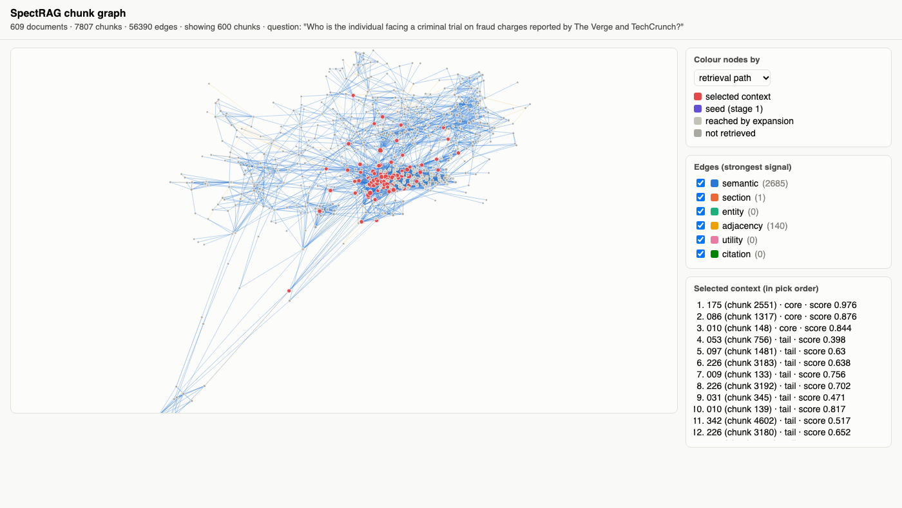

<p align="center"></p>

<h3 align="center">Spectral graph-augmented retrieval with token-budgeted context selection for multi-hop RAG</h3>

<p align="center">
  <a href="https://github.com/aion7891/Spect-RAG/actions/workflows/tests.yml"></a>
  
  
  
  <a href="https://arxiv.org/abs/2610.36991"></a>
</p>

<p align="center">
  <a href="#installation">Installation</a> ·
  <a href="#quick-start">Quick start</a> ·
  <a href="#how-it-works">How it works</a> ·
  <a href="#graph-view">Graph view</a> ·
  <a href="#configuration">Configuration</a> ·
  <a href="#benchmark-multihoprag">Benchmark</a> ·
  <a href="#citation">Citation</a>
</p>

---

A readable, tested Python implementation of the paper *SpectRAG: Weighted Chunk Graphs for
Token-Budgeted Context Selection in Multi-Hop Retrieval-Augmented Generation*
(Sahinoglu et al., [arXiv:2610.36991](https://arxiv.org/abs/2610.36991), [PDF](docs/2610.36991v2.pdf)).

| | Plain top-k RAG | SpectRAG |
|---|---|---|
| **Unit of retrieval** | chunks ranked one by one | a *set* of chunks chosen together |
| **Near-duplicates** | often fill the context | penalised (redundancy term) |
| **Bridge evidence** (not similar to the question, but needed) | usually missed | reached by walking a weighted chunk graph |
| **Structure** (sections, entities, citations, order) | ignored | six edge signals and spectral coordinates |
| **Context size** | a fixed *k* | a token budget, filled by relevance, coverage and diversity |

<p align="center"></p>

## Highlights

<table>
<tr>
<td width="50%" valign="top">

**The full method from the paper**<br>
Six edge signals, the normalised Laplacian and spectral coordinates, hybrid seeds with RRF,
two-hop graph expansion, PageRank and spectral proximity, the token-budget selector, and the
paper's alternative selectors (`mmr`, `protected_mmr`, `anchor_expand_ce`).

</td>
<td width="50%" valign="top">

**Measured, not claimed**<br>
A reproducible MultiHopRAG benchmark (1,955 test questions) against standard RAG, BM25, hybrid
RAG, MMR, HyDE and LightRAG, with confidence intervals, ablations, latency and memory.

</td>
</tr>
<tr>
<td valign="top">

**Light and offline by default**<br>
One required dependency (`numpy`). An offline embedder out of the box; plug in
`nomic-embed-text`, any embedding function, and any LLM.

</td>
<td valign="top">

**Built to scale**<br>
Exact, FAISS or HNSW vector search, a sparse eigensolver above 2,000 chunks, binary index
files: about 4 ms per query on 10k chunks.

</td>
</tr>
<tr>
<td valign="top">

**Configurable and tunable**<br>
39 validated settings, per-query overrides, graph settings changed without re-embedding, and a
grid / random-search tuner.

</td>
<td valign="top">

**See what it retrieves**<br>
An interactive graph view of the chunk graph and of each question's retrieval path, in one
offline HTML file.

</td>
</tr>
</table>

> [!TIP]
> On MultiHopRAG, tuned SpectRAG finds more of the evidence than **standard RAG (+0.088)** and
> **hybrid RAG (+0.014, 95% CI +0.007 … +0.021)** within the same 12,000-token budget, with
> its largest gain on inference questions. [See the benchmark.](#benchmark-multihoprag)

## Installation

```bash
pip install "git+https://github.com/aion7891/Spect-RAG.git"                  # core (numpy only)
pip install "spectrag[all] @ git+https://github.com/aion7891/Spect-RAG.git"   # every extra
```

> [!NOTE]
> Installing from GitHub uses the default branch (`main`). Until the 0.1.0 work is merged
> into `main`, add `@base-2` to the URL, e.g. `pip install "git+https://github.com/aion7891/Spect-RAG.git@base-2"`.

From a clone (for development):

```bash
git clone https://github.com/aion7891/Spect-RAG.git && cd Spect-RAG
pip install -e ".[all,dev]"        # or: uv sync --all-extras
```

| Extra | Installs | Adds |
|---|---|---|
| `tokens` | `tiktoken` | exact `cl100k_base` token counts (otherwise a word-based estimate) |
| `pdf` | `pypdf` | reading `.pdf` files |
| `scale` | `scipy`, `faiss-cpu`, `hnswlib` | sparse eigensolver and approximate nearest-neighbour search for large corpora |
| `all` | all of the above | |
| `dev` | `pytest`, `build` | tests and packaging |

Real semantic embeddings and LLM answers use a local [Ollama](https://ollama.com) server:
`ollama pull nomic-embed-text` (the paper's embedding model) and, for answers, e.g.
`ollama pull gemma3:4b`. Without Ollama, SpectRAG uses an offline hashing embedder.

Python 3.10–3.14 are tested. There is no upper version limit; Python 3.15 is waiting for a
numpy release that supports it.

## Quick start

```bash
python quickstart.py
```

`quickstart.py` needs no arguments. It ingests the sample documents in `examples/docs/`, builds
the index, and prints the context for two questions. The documents, questions and every setting
are at the top of the file; set `USE_OLLAMA = True` for nomic embeddings and LLM answers.

### Python

```python
from spectrag import SpectRAGIngestion, SpectRAGRetrieval

# Offline, once per document set: chunk, embed, build the graph, spectral coordinates
SpectRAGIngestion("my_index").ingest("examples/docs")      # a file or a folder (.txt .md .pdf)

# Online, per question
search = SpectRAGRetrieval("my_index")
result = search.search("Which company did the co-founder of Aurora Labs join after leaving?")
print(result["context"])                # text for your LLM, grouped by source document
for chunk in result["chunks"]:          # ranked sources with their scores
    print(chunk["rank"], chunk["doc_id"], round(chunk["score"], 3), chunk["reason"])

# Optional: an answer from any LLM (any function prompt -> text)
from spectrag.utils.llm import ollama_llm
print(search.answer("Which company did the co-founder of Aurora Labs join?", ollama_llm("gemma3:4b"))["answer"])
```

Documents can also come from memory:
`SpectRAGIngestion("my_index").ingest_documents([{"doc_id": "a", "text": "..."}])`.

### Command line

```bash
spectrag ingest examples/docs --index my_index --set chunk_tokens=256 --set overlap_tokens=64
spectrag search "Where is Helios Energy based?" --index my_index --budget 2000
spectrag answer "Where is Helios Energy based?" --index my_index --model gemma3:4b
spectrag graph --index my_index --out graph.html --question "Where is Helios Energy based?"
spectrag info --index my_index
```

`--set key=value` changes any setting (values are read as JSON); `-v` prints progress.

## How it works

**Offline: `SpectRAGIngestion`** (once per document set)

| Step | What happens | Paper |
|---|---|---|
| 1. Chunking | Split by headings, keeping the section path, or where the topic changes (90th-percentile sentence distance). At most 1,200 tokens, 100 overlap; sentences and table rows are never cut | Section 3.3 |
| 2. Embedding | `nomic-embed-text` with the `search_document:` prefix (or the offline embedder, or your function), L2-normalised | Table 1 |
| 3. Edge signals | Six links between chunks, each in [0, 1]: semantic (k nearest neighbours), adjacency, section, shared entities, utility questions, citations | Section 3.2.1 |
| 4. Weighted graph | Weighted sum of the signals; weak edges dropped; each chunk keeps its `graph_k` strongest edges | Eq. 10 |
| 5. Spectral coordinates | The smallest non-trivial eigenvectors of the normalised Laplacian give each chunk 32 numbers that say *where it sits* in the graph's communities, not what it says | Eq. 11–13 |

**Online: `SpectRAGRetrieval`** (per question)

| Step | What happens | Paper |
|---|---|---|
| 1. Hybrid seeds | Dense, BM25 and utility-question rankings fused with RRF → 20 seeds and a relevance score for every chunk | Table 2 |
| 2. Graph expansion | Breadth-first search, 2 hops from the seeds, at most 200 candidates: this is where bridge evidence enters | Section 3.6 |
| 3. Proximity re-scoring | Relevance blended with graph proximity (Personalized PageRank + spectral closeness) | Eq. 17–18 |
| 4. Token-budget selection | A protected core, a greedy tail that trades relevance against redundancy, coverage and length, then backfill; never over the budget | Eq. 19–22 |
| 5. Answer | The context, grouped by document, in a grounded prompt for any LLM | Algorithm 1 |

<details>
<summary><b>Key equations</b></summary>

Weighted graph (Eq. 10), with edges below $\tau$ removed:

```math
w_{ij} = \sum_{r} \alpha_r \, w^{(r)}_{ij}
```

Normalised Laplacian (Eq. 11); the spectral coordinates are eigenvectors $u_2 \dots u_{33}$:

```math
L_{sym} = I - D^{-1/2} \, W \, D^{-1/2}
```

Personalized PageRank from the seeds (Eq. 18), and the re-score:

```math
s^{(t+1)} = \beta \, r + (1-\beta)\, \tilde{A}\, s^{(t)}, \qquad
\text{score} = (1-\alpha)\,\text{relevance} + \alpha\,\text{proximity}
```

Greedy selection under the token budget $B$ (Eq. 21–22):

```math
U(c \mid C) = a\, s_c + b\,\text{Prox}(c) + c\,\text{ClusterGain}(c, C) + d\,\text{DocGain}(c, C) - \lambda\,\text{Red}(c, C),
\qquad c^{*} = \arg\max_{c} \frac{U(c \mid C)}{\ell(c)^{\rho}}, \quad \sum_{c \in C} \ell(c) \le B
```

</details>

Every place where the paper leaves a detail open, and what this code chose, is listed in
[docs/DESIGN.md](docs/DESIGN.md) (D1–D64).

## Graph view

`spectrag graph` (or `spectrag.utils.graph_view.save_graph_view`) writes one self-contained HTML
file, similar to Figure 5 of the paper. Chunks are drawn as nodes, starting from their spectral
coordinates, and edges are coloured by their strongest signal. For a question it shows the
retrieval path: seeds, chunks reached by expansion, and the selected context. Hover for a
chunk's text, click to highlight its neighbours, scroll to zoom, drag to pan, and hide signals
with the checkboxes. It needs no internet. Example: [`examples/graph_view.html`](examples/graph_view.html)
(download and open it in a browser).

<p align="center"></p>

## Configuration

Settings are a plain dict. Pass changes to `SpectRAGIngestion(dir, settings)`,
`SpectRAGRetrieval(dir, settings)`, `search(q, settings=...)`, or `--set` on the CLI. Every
value is checked: a typo gets "did you mean …?", a bad value says which range is allowed.
**Source** says whether the default comes from the paper or was chosen because the paper gives no value.

<details open>
<summary><b>Chunking (ingestion)</b></summary>

| Setting | Default | Meaning | Source |
|---|---|---|---|
| `chunk_tokens` / `overlap_tokens` | 1200 / 100 | maximum chunk size and overlap, in tokens | paper |
| `min_chunk_tokens` | 32 | smaller chunks are merged into the previous one | paper |
| `semantic_percentile` | 90 | topic breaks at this percentile of sentence distances | paper |
| `semantic_embedder` | `None` | embedder for those distances; `None` = the same as `embedder`, `"hash"` = much faster | chosen |

</details>

<details>
<summary><b>Embedding (ingestion)</b></summary>

| Setting | Default | Meaning | Source |
|---|---|---|---|
| `embedder` | `"hash"` | `"hash"` (offline), `"ollama"`, or a function `texts -> vectors` | chosen |
| `embed_dims` | 768 | size of the hash vectors | paper |
| `ollama_model` / `ollama_url` | `nomic-embed-text` / `http://localhost:11434` | Ollama embedding model and server | paper |

</details>

<details>
<summary><b>Vector search</b></summary>

| Setting | Default | Meaning | Source |
|---|---|---|---|
| `ann_backend` | `"auto"` | `"exact"`, `"faiss"`, `"hnsw"`, or `"auto"` (exact up to 20,000 chunks) | chosen |
| `hnsw_m` / `hnsw_ef_construction` / `hnsw_ef_search` | 32 / 200 / 128 | HNSW graph size and search effort | chosen |
| `dense_top_n` | 1000 | with an approximate backend, dense scores for the top *n* chunks only | chosen |

</details>

<details>
<summary><b>Graph (ingestion; change later with <code>rebuild_graph()</code>)</b></summary>

| Setting | Default | Meaning | Source |
|---|---|---|---|
| `edge_weights` | semantic .300, section .250, entity .200, adjacency .084, utility .083, citation .083 | α of Eq. 10 (paper configuration 1); empty signals share their weight | paper |
| `semantic_k` | 10 | nearest neighbours per chunk for semantic and utility edges | chosen |
| `edge_threshold` | 0.05 | τ: fused edges below this are dropped | chosen |
| `graph_k` | 10 | each chunk keeps at most its `graph_k` strongest edges | chosen |
| `spectral_dims` | 32 | spectral coordinates per chunk | paper |
| `n_clusters` | `None` | spectral clusters; `None` = about √(n/2) | chosen |

</details>

<details>
<summary><b>Retrieval</b></summary>

| Setting | Default | Meaning | Source |
|---|---|---|---|
| `seed_count` | 20 | seeds from hybrid search | paper |
| `hops` / `max_candidates` | 2 / 200 | graph expansion depth and cap | paper |
| `token_budget` | 12000 | tokens of context per question | paper |
| `rrf_k` | 60 | RRF constant | chosen |
| `bm25_k1` / `bm25_b` | 1.5 / 0.75 | BM25 parameters | chosen |
| `bm25_weight` | 0.5 | hybrid relevance = (1 − w)·dense + w·BM25 | chosen |
| `alpha` | 0.3 | weight of graph proximity in the re-score | chosen |
| `proximity_mode` | `"hybrid"` | `"hybrid"` (PageRank + spectral), `"ppr"`, `"spectral"`, `"heat"` (Eq. 17), `"none"` | paper |
| `ppr_beta` / `ppr_steps` | 0.15 / 30 | PageRank restart share and iterations (Eq. 18) | chosen |
| `diffusion_t` | 1.0 | heat-kernel scale t | chosen |

</details>

<details>
<summary><b>Selection</b></summary>

| Setting | Default | Meaning | Source |
|---|---|---|---|
| `selector` | `"spectrag"` | `"spectrag"`, `"mmr"`, `"protected_mmr"`, `"anchor_expand_ce"`, `"topk"` | paper |
| `core_size` | 3 | protected core (and anchors) | chosen |
| `precision_floor` | 0.4 | greedy-tail candidates must score ≥ this × the best score | chosen |
| `select_weights` | a 1.0, b 0.3, c 0.2, d 0.1, λ 0.5 | weights of Eq. 21 | chosen |
| `length_power` | 0.5 | ρ of Eq. 22 (how much short chunks are preferred) | chosen |
| `mmr_lambda` | 0.7 | MMR: relevance vs. novelty | chosen |

</details>

> [!NOTE]
> The defaults of this first release follow the paper where it gives values. On MultiHopRAG,
> settings tuned on validation questions were clearly better (see the benchmark); tuned
> defaults are planned for a later release.

### Tuning

```python
from spectrag import SpectRAGIngestion, SpectRAGRetrieval
from spectrag.utils.evaluation import load_questions
from spectrag.utils.tuning import tune

SpectRAGIngestion("eval_index").ingest("examples/eval/docs")     # the documents the questions are about
search = SpectRAGRetrieval("eval_index")
questions = load_questions("examples/eval/questions.json")   # [{"question", "evidence": [...]}, ...]
grid = {"alpha": [0.1, 0.3, 0.5], "selector": ["spectrag", "protected_mmr"], "edge_threshold": [0.05, 0.1]}
results = tune(search, questions, grid, objective="recall", budget=4000, trials=10)
print(results[0])                                            # best settings and their scores
```

Graph settings (`edge_threshold`, `graph_k`, `edge_weights`, `spectral_dims`, `n_clusters`) are
applied by `search.rebuild_graph({...})` from the saved signals, so nothing is embedded again.

### Your own models

| Plug-in | Where | Signature |
|---|---|---|
| Embedder | `settings={"embedder": fn}` (pass `embed_fn=fn` again when searching) | `fn(texts) -> vectors` |
| LLM for answers | `search.answer(question, llm_fn)` | `llm_fn(prompt) -> text` |
| Entity extractor | `SpectRAGIngestion(..., entity_fn=fn)` | `fn(text) -> list of strings` |
| Utility questions | `SpectRAGIngestion(..., question_fn=make_question_fn(llm_fn))` | `fn(text) -> list of questions` |
| Cross-encoder | `SpectRAGRetrieval(..., rerank_fn=fn)` with `selector="anchor_expand_ce"` | `fn(question, texts) -> scores` |

### Errors and logging

All errors raised on purpose subclass `spectrag.SpectRAGError` and the matching built-in:
`SettingsError` (`ValueError`), `UnknownSettingError` (`KeyError`), `IndexError_`
(`FileNotFoundError`), `EmbedderError` (`ConnectionError`), `DocumentError` (`ValueError`).
SpectRAG is silent by default; `spectrag.enable_logging()` prints one timed line per pipeline
step, and `enable_logging("DEBUG")` one line per query.

## Benchmark: MultiHopRAG

Real runs on [MultiHopRAG](https://arxiv.org/abs/2401.15391): 609 news articles, 7,807 chunks,
`nomic-embed-text` embeddings, a **12,000-token budget for every method**. 300 questions were
used only for tuning; all numbers below are on the other **1,955 test questions**.

| Method | Recall@5 | Recall@10 | Evidence recall (budget) | All evidence found | MRR | ms / query |
|---|---|---|---|---|---|---|
| Standard RAG (dense top-k) | 0.355 | 0.483 | 0.758 | 0.512 | 0.507 | 1.3 |
| BM25 | 0.462 | 0.577 | 0.788 | 0.545 | 0.617 | 1.0 |
| Dense + MMR | 0.359 | 0.482 | 0.756 | 0.507 | 0.508 | 1.3 |
| Hybrid RAG (dense + BM25, RRF) | 0.445 | 0.574 | 0.832 | 0.615 | 0.609 | 2.8 |
| SpectRAG, default settings | 0.385 | 0.433 | 0.803 | 0.550 | 0.592 | 4.4 |
| **SpectRAG, tuned on validation** | **0.470** | **0.592** | **0.846** | **0.639** | **0.617** | 3.5 |

<p align="center"> </p>

- **Tuned SpectRAG beats hybrid RAG**: evidence recall +0.014 (95% CI +0.007 … +0.021),
  Recall@10 +0.017 (+0.009 … +0.025). Its largest gain is on **inference** questions
  (0.802 vs 0.757); on comparison questions hybrid stays slightly ahead, as in the paper.
- Removing graph expansion drops evidence recall to 0.705: the graph walk is where most of the
  extra evidence comes from.
- **Smaller tests:** HyDE (60 questions): 0.760, against dense 0.807. Answers with `gemma3:4b`
  (30 questions): exact match 0.400 tuned SpectRAG, 0.333 dense, 0.267 hybrid (one answer = 0.033).
  LightRAG on a 4-article subset could not be compared fairly (the subset fits in the budget), and
  it needed about 225 s of LLM time per 1,000-word article to index.

> [!IMPORTANT]
> **The default settings are weaker than hybrid RAG** (0.803 vs 0.832). The paper's greedy
> selector with ρ = 0.5 (a value the paper does not give) prefers very short chunks. With
> `length_power = 0`, Recall@10 rises from 0.433 to 0.580, and the `topk` / `mmr` selectors reach
> 0.845 with no tuning. Tune on your own validation questions before relying on the defaults.

Reproduce (needs Ollama; quick mode takes minutes, `SPECTRAG_BENCH_FULL=1` runs the full version):

```bash
python benchmarks/multihoprag_benchmark.py      # index, tune, evaluate, latency
python benchmarks/mhr_llm_steps.py hyde          # and: answers
python benchmarks/mhr_report.py                 # REPORT.md and the charts
python benchmarks/ann_benchmark.py              # exact vs FAISS vs HNSW
```

Full results, per-type tables, ablations and the method: [benchmarks/results/multihoprag/REPORT.md](benchmarks/results/multihoprag/REPORT.md)
and [docs/PROGRESS.md](docs/PROGRESS.md). The dataset (ODC-BY) is stored in
[`benchmarks/data/multihoprag/`](benchmarks/data/multihoprag/SOURCE.md) with checksums.

<details>
<summary><b>Scale and memory</b></summary>

| Corpus | Ingestion | Search (median) | Index | Memory |
|---|---|---|---|---|
| MultiHopRAG, 609 articles → 10,335 chunks (hash embedder) | 7.7 s | 4.1 ms | 49 MB | about 1 GB peak during ingestion |
| MultiHopRAG, 7,807 chunks (nomic-embed-text) | dominated by embedding through Ollama | 3.5–4.4 ms + 19 ms query embedding | 39.5 MB | 256 MB after loading |
| 100,000 synthetic 768-d vectors, kNN graph | exact 70.9 s, **FAISS 10.4 s** (same edges) | | | |

</details>

## Project layout

<details>
<summary><b>Show the folders and modules</b></summary>

```
src/spectrag/
  ingestion.py, retrieval.py         the two main classes
  config.py, validation.py           settings and their checks
  errors.py, log.py, cli.py          exceptions, logging, the spectrag command
  utils/                             one small module per step: loader, tokens, sections, units,
                                     chunker, embedder, entities, references, questions, edges*,
                                     graph, graph_build, spectral, clusters, vector_index, bm25,
                                     seeding, expansion, diffusion, selection, selectors, prompt,
                                     llm, metrics, evaluation, tuning, graph_view, store
quickstart.py                        runs with no arguments
examples/                            sample documents, a 14-document evaluation set, demo scripts
benchmarks/                          MultiHopRAG and ANN benchmarks, their data and results
tests/                               unit, integration and equivalence tests
docs/                                the paper, DESIGN.md, PROGRESS.md, PRODUCTION_READINESS.md,
                                     DEVELOPMENT_LOG.md
tools/                               validate_release.py (release checks on a real index)
```

</details>

Every module is short (under about 150 lines), and functions do one thing.

## Testing

```bash
pytest -q          # 300+ tests, under 10 seconds, offline
```

The tests cover every formula against hand-computed or closed-form values (BM25, RRF,
PageRank, the heat kernel against `scipy.linalg.expm`, the sparse eigensolver against the dense
one, the paper's metrics). The fast vectorised code is checked against simple loop versions on
random cases, and the full pipeline runs end to end on real documents. Live Ollama tests run
when Ollama is available (`SPECTRAG_LIVE_LLM=1` for the LLM test). CI runs Linux and macOS ×
Python 3.10 / 3.12 / 3.14 × minimal / all extras, and builds and installs the wheel.

Before a release, `python tools/validate_release.py` re-checks the mathematics on the real
MultiHopRAG index (eigenpairs, PageRank, BM25, every selector and proximity mode) and that the
benchmark reproduces. The results are in the
[production-readiness report](docs/PRODUCTION_READINESS.md).

## Limitations

- The default settings are not tuned (see the benchmark). Tuning on your own validation
  questions is recommended.
- Entity extraction is rule-based unless you pass an `entity_fn`; utility questions need an LLM.
- Semantic edges and the dense eigensolver are `O(n²)` without the `scale` extra.
- The benchmark is a quick-mode run on one dataset; LightRAG was only compared on a tiny subset.
- On macOS with numpy 2.2 (Python 3.10), matrix products print spurious `RuntimeWarning`s; the
  results are correct.

More: [docs/DESIGN.md](docs/DESIGN.md) (every decision), [docs/PROGRESS.md](docs/PROGRESS.md)
(the upgrade, with measurements), [CHANGELOG.md](CHANGELOG.md).

## Citation

If you use SpectRAG, please cite the paper:

```bibtex
@article{sahinoglu2026spectrag,
  title   = {SpectRAG: Weighted Chunk Graphs for Token-Budgeted Context Selection in
             Multi-Hop Retrieval-Augmented Generation},
  author  = {Sahinoglu, Zafer and Mohammed, Abdulazeez and Kazangirler, Buse Yaren and
             Kazangirler, Cahit Berkay},
  journal = {arXiv preprint arXiv:2610.36991},
  year    = {2026}
}
```

## License

MIT, see [LICENSE](LICENSE). The MultiHopRAG data in `benchmarks/data/` is ODC-BY
(see its [SOURCE.md](benchmarks/data/multihoprag/SOURCE.md)).
