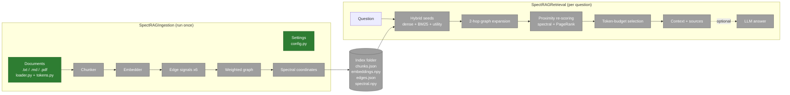
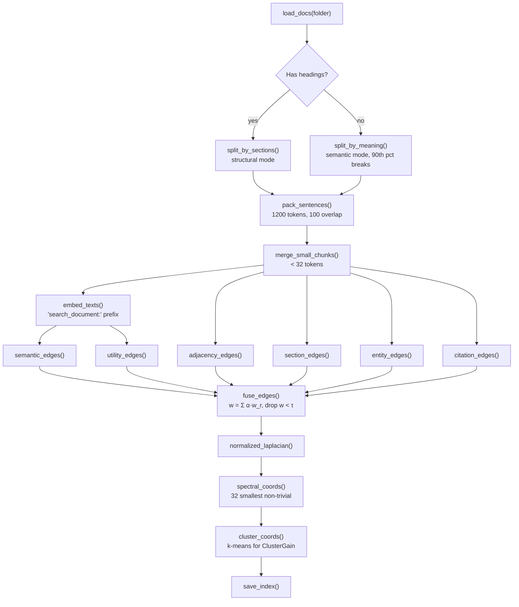
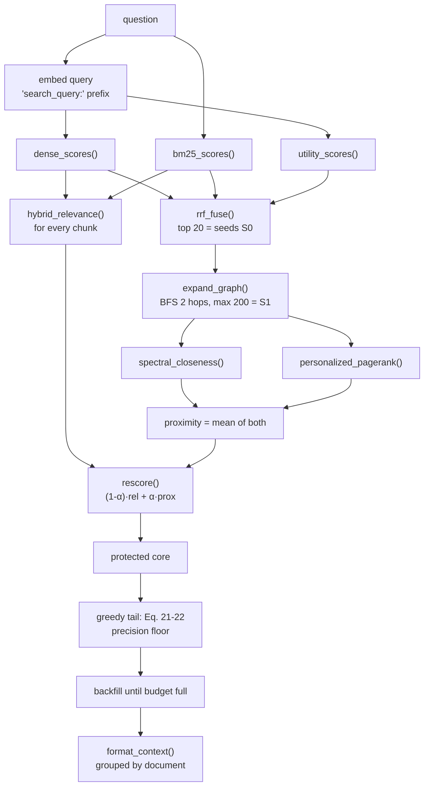
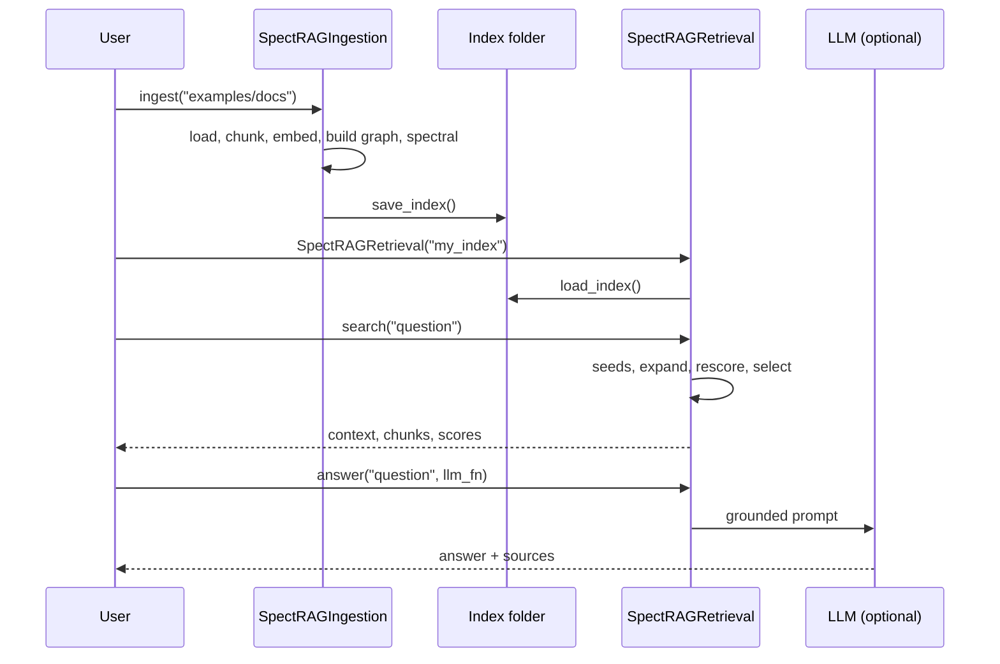
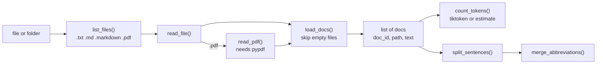

# SpectRAG — a small, readable Python implementation

SpectRAG is a retrieval method for RAG (Retrieval-Augmented Generation). It comes from the paper
**"SpectRAG: Weighted Chunk Graphs for Token-Budgeted Context Selection in Multi-Hop
Retrieval-Augmented Generation"** (Sahinoglu et al., arXiv:2610.36991v2), included at
[`docs/2610.36991v2.pdf`](docs/2610.36991v2.pdf).

This repository rebuilds the method as a **lightweight, beginner-friendly Python package**:
short files, small functions, `numpy` as the only required dependency, and tests for every phase.

> **Project status:** Phases 1–2 of 10 are done: paper analysis, architecture, package skeleton,
> settings, document loader, and token counter. Chunking (Phase 3) is next. See
> [Section 11](#11-implementation-phases-and-progress) for progress and
> [Section 15](#15-what-is-implemented-so-far) for the code that exists today.

---

## Table of contents

1. [SpectRAG in plain words](#1-spectrag-in-plain-words)
2. [Paper analysis](#2-paper-analysis)
3. [Architecture](#3-architecture)
4. [Ingestion flow (offline)](#4-ingestion-flow-offline)
5. [Retrieval flow (online)](#5-retrieval-flow-online)
6. [Execution flow](#6-execution-flow)
7. [Package folder structure](#7-package-folder-structure)
8. [Planned scripts and functions](#8-planned-scripts-and-functions)
9. [Settings: paper values and our defaults](#9-settings-paper-values-and-our-defaults)
10. [Assumptions and deviations from the paper](#10-assumptions-and-deviations-from-the-paper)
11. [Implementation phases and progress](#11-implementation-phases-and-progress)
12. [Installation and usage (planned)](#12-installation-and-usage-planned)
13. [Testing strategy](#13-testing-strategy)
14. [Known issues](#14-known-issues)
15. [What is implemented so far](#15-what-is-implemented-so-far)

---

## 1. SpectRAG in plain words

A normal RAG system splits documents into **chunks**, turns every chunk into a vector, and returns
the *top-k* chunks closest to the question. The paper names three problems with that:

| Problem | What goes wrong |
|---|---|
| **Redundancy** | Near-duplicate chunks sit close together in vector space, so top-k returns several copies of the same fact. |
| **Missing bridge evidence** | Multi-hop questions need "connector" chunks that are not similar to the question itself, so top-k skips them. |
| **Structure blindness** | Chunks are treated as unrelated, even though they share sections, entities, citations, and document order. |

SpectRAG treats retrieval as **picking a good *set* of chunks**, not a list of individually good chunks:

1. **Build a graph** where every chunk is a node. Edges join chunks that are related in any of six
   ways: similar meaning, next to each other, same section, shared names, one cites the other, or
   they answer similar questions.
2. **Compute "spectral coordinates"** from the graph's Laplacian matrix. Each chunk gets a small
   vector (32 numbers) that says *where it sits in the graph's communities*, not what it says.
3. At question time, **find seed chunks** using dense vectors + BM25 keywords + question matching.
4. **Walk the graph** two hops out from the seeds to collect connector chunks.
5. **Spread relevance** across the graph (PageRank-style), so connectors close to strong seeds
   score higher.
6. **Fill a token budget** (about 12k tokens): keep the best chunks, then add chunks that cover new
   communities and new documents and repeat little, until the budget is full.

---

## 2. Paper analysis

### 2.1 The core idea (Eq. 8–9)

The paper sets retrieval up as choosing a context set `C` that maximises

```
F(C, q) = Σ Rel(c, q)  −  λ Σ Red(ci, cj)  +  γ Cov(C, q)  +  η Conn(C; G)
          relevance       redundancy          coverage        graph connectivity
```

With `λ = γ = η = 0` this reduces to plain top-k. Picking the best set exactly is too slow, so
the paper approximates it with the pipeline below and a greedy selection rule (Eq. 21–22).

### 2.2 Offline pipeline (paper Table 1), run once per document collection

| Step | Paper | What it produces |
|---|---|---|
| Chunking | Structural (headings) or semantic (sentence-embedding breakpoints at the 90th percentile). `cl100k_base` tokens: 1200 per chunk, 100 overlap. Never cuts mid-sentence; chunks under 32 tokens merge into the previous one; tables are kept whole as Markdown. | Chunks with text, position, section path, references |
| Embedding | `nomic-embed-text` (768-d), `search_document:` prefix, L2-normalised, FAISS `IndexFlatIP` (exact search) | One vector per chunk |
| Edge signals | Six extractors (Eq. 10); entities and utility questions come from `gpt-4o-mini` | Six edge lists `(i, j, weight)` |
| Graph build | `w_ij = Σ α_r · w_r,ij`; drop edges with `w_ij < τ` | Weighted graph `G = (V, E, W)` |
| Spectral decomposition | `L_sym = I − D^-1/2 W D^-1/2` (Eq. 11); the 32 smallest non-trivial eigenvectors (Eq. 12–13) | 32-d spectral coordinates `z_i` per chunk |
| Neo4j write | Stores the graph in Neo4j | Persistent graph |
| Persist | `chunks.pkl` + `faiss.index` | Files on disk |

**The six edge signals (Section 3.2.1), each scaled to [0, 1]:**

| Signal | Meaning | Paper weight (config 1) | Paper weight (config 2) |
|---|---|---|---|
| Semantic | `max(0, cos(e_i, e_j))`, only for each node's `k_g` nearest neighbours | 0.300 | 0.150 |
| Hierarchy (section) | Same heading or parent section | 0.250 | 0.200 |
| Entity | Overlap in names, terms, organisations, dates | 0.200 | 0.250 |
| Adjacency | Consecutive chunks in the same document | 0.084 | 0.100 |
| Utility question | Similarity of LLM-generated "questions this chunk answers" | 0.083 | 0.280 |
| Citation | References, hyperlinks, footnotes, "see Section X" | 0.083 | 0.020 |

### 2.3 Online pipeline (paper Table 2 and Algorithm 1), run per question

| Stage | Paper | Output |
|---|---|---|
| 1. Hybrid seed retrieval | Reciprocal Rank Fusion (RRF) of dense cosine, BM25, and query-to-utility-question matching. The relevance passed downstream is hybrid (dense + BM25). | Seed set `S0` (20 chunks) and a relevance score for every chunk |
| 2. Graph expansion | Two-hop breadth-first search (BFS) from `S0`, capped at 200 nodes | Candidate set `S1` and its subgraph |
| 3. Proximity re-scoring | `s2 = (1 − α)·relevance + α·proximity`; proximity = mean of *spectral closeness* and *Personalized PageRank* from the seeds | Re-scored candidates `S2` |
| 4. Token-budget selection | About 12k tokens: protected core, tail precision floor, document-coverage tie-break, backfill (Eq. 19–22) | Final context `C`, usually 10–15 chunks |
| 5. Generation | Context grouped by source document; `gpt-4o-mini`, temperature 0, grounded prompt | Answer and ranked sources |

**Diffusion (Section 3.7).** The exact form is `s' = exp(−t·L_sym)·s` (Eq. 17). The paper's
practical version is the repeated smoothing in Eq. 18:
`s(r+1) = β·s + (1 − β)·Ã·s(r)` with `à = D^-1/2 A D^-1/2`. This is Personalized PageRank.

**Selection score (Eq. 21–22).** Each greedy step picks the candidate that maximises

```
U(c | C) = a·s_c + b·Prox(c, S0) + c·ClusterGain(c, C) + d·DocGain(c, C) − λ·Red(c, C)
pick  argmax  U(c | C) / tokens(c)^ρ          (ρ in [0, 1] sets how much length matters)
```

### 2.4 Main reported results (for context only; we do not reproduce the benchmarks)

- On MultiHopRAG: highest overall recall (91.8) and Recall@10 (84.0). Strong hybrid retrieval is
  still better on early precision (R@2, R@5, MRR).
- Answer accuracy is highest of the five systems, by a small margin (EM 71.2 vs 70.6). Gains are
  largest on *inference* questions.
- The graph has 2.8–6.6× fewer nodes than LightRAG, and the index is about 6× smaller (46 MB vs 274 MB).
- In LLM-judge comparisons, **diversity** is the most consistent win.

### 2.5 Inconsistencies found in the paper, and how we resolve them

| Where | Inconsistency | Our choice |
|---|---|---|
| Eq. 2 vs Eq. 10 | Eq. 2 lists 5 signals, Eq. 10 lists 6 | Use the 6 signals of Eq. 10 |
| Eq. 15 vs Table 2 / Alg. 1 | Eq. 15 seeds by dense similarity only; Table 2 uses RRF of three rankings | Follow Table 2 / Algorithm 1 (hybrid RRF) |
| Section 3.2.3 vs Table 1 | "Smallest *non-trivial*" vs "32 smallest" eigenvectors | Skip the trivial first eigenvector (Eq. 13: `u2 … u_{m+1}`) |
| Eq. 17 vs Table 2 | Heat-kernel diffusion vs Personalized PageRank | Use PPR (Eq. 18) as the default |
| Eq. 9 vs Eq. 21 | `Cov` and `Conn` in the objective vs `ClusterGain`, `DocGain`, `Prox` in the greedy rule | Implement Eq. 21–22, the rule the paper actually uses |
| Section 6 vs Table 8 | The text says SpectRAG is best on null questions; the table shows it is not | Does not affect the implementation |

---

## 3. Architecture

Two main classes share one index folder on disk:



Colours: green = done, yellow = in progress, grey = pending.

**Design rules**

- **Pluggable models.** Embedding, entity extraction, utility questions, and answer generation are
  plain Python functions you can swap. Defaults need no internet and no API key, so every test
  runs offline.
- **No database server.** The paper uses Neo4j and FAISS. We keep the graph as a Python dict and
  search with `numpy` dot products (the same exact math as `IndexFlatIP`).
- **Files you can read.** The index is JSON plus `.npy` files, so you can open and inspect it.

---

## 4. Ingestion flow (offline)



---

## 5. Retrieval flow (online)



---

## 6. Execution flow

What happens when a user runs the package end to end:



---

## 7. Package folder structure

Planned layout (files are created phase by phase):

```
Spect-RAG/
├── README.md
├── pyproject.toml
├── docs/
│   └── 2610.36991v2.pdf            # the paper
├── examples/
│   ├── docs/                       # small sample documents
│   ├── ingest_example.py
│   └── search_example.py
├── src/
│   └── spectrag/
│       ├── __init__.py             # exports SpectRAGIngestion, SpectRAGRetrieval
│       ├── config.py               # default settings (paper values)
│       ├── ingestion.py            # class SpectRAGIngestion
│       ├── retrieval.py            # class SpectRAGRetrieval
│       └── utils/
│           ├── __init__.py
│           ├── loader.py           # read .txt/.md/.pdf files
│           ├── tokens.py           # count tokens, split sentences
│           ├── chunker.py          # structural chunking + packing
│           ├── semantic_split.py   # semantic chunking
│           ├── embedder.py         # hashing embedder + Ollama nomic-embed-text
│           ├── entities.py         # simple entity extraction
│           ├── edges.py            # the six edge signals
│           ├── graph.py            # fuse weights, adjacency, neighbours
│           ├── spectral.py         # Laplacian, eigenvectors, clusters
│           ├── store.py            # save/load the index
│           ├── bm25.py             # BM25 keyword scoring
│           ├── seeding.py          # dense/BM25/utility scores + RRF
│           ├── expansion.py        # BFS graph expansion
│           ├── diffusion.py        # PageRank + spectral proximity + re-score
│           ├── selection.py        # token-budget context selection
│           └── prompt.py           # format context, optional answer
└── tests/
    ├── test_tokens.py
    ├── test_chunker.py
    └── ...                         # one test file per utils module
```

**Why `src/spectrag/utils/` rather than `src/utils/`:** a top-level package called `utils` would
clash with any other `utils` module once installed. Nesting it under `spectrag` keeps everything
inside `src/` and makes it importable as `spectrag.utils`.

---

## 8. Planned scripts and functions

Every function is meant to be about 5–20 lines and do one job.

| File | Main functions | Purpose |
|---|---|---|
| `config.py` | `DEFAULTS`, `make_settings(overrides)` | One dict of settings; users override only what they need |
| `utils/loader.py` | `load_docs(path)`, `read_file(path)` | Read a file or a folder into `{"doc_id", "text"}` dicts |
| `utils/tokens.py` | `count_tokens(text)`, `split_sentences(text)` | `tiktoken` when installed, otherwise a word-based estimate |
| `utils/chunker.py` | `split_by_sections()`, `pack_sentences()`, `merge_small_chunks()`, `find_tables()` | Heading-aware chunks with overlap, tables kept whole |
| `utils/semantic_split.py` | `split_by_meaning()`, `find_breakpoints()` | Break where sentence distance is above the 90th percentile |
| `utils/embedder.py` | `hash_embed(texts)`, `ollama_embed(texts)`, `normalize(vectors)` | Offline default embedder; optional real `nomic-embed-text` |
| `utils/entities.py` | `extract_entities(text)` | Capitalised phrases, acronyms, numbers, dates (regex) |
| `utils/edges.py` | `semantic_edges()`, `adjacency_edges()`, `section_edges()`, `entity_edges()`, `citation_edges()`, `utility_edges()` | Six lists of `(i, j, weight)` |
| `utils/graph.py` | `fuse_edges()`, `build_matrix()`, `neighbors()` | Weighted sum, threshold `τ`, adjacency matrix |
| `utils/spectral.py` | `normalized_laplacian()`, `spectral_coords()`, `cluster_coords()` | Eq. 11–13 plus k-means labels |
| `utils/store.py` | `save_index()`, `load_index()` | JSON + `.npy` on disk |
| `utils/bm25.py` | `build_bm25()`, `bm25_scores()` | Classic BM25 in pure Python |
| `utils/seeding.py` | `dense_scores()`, `utility_scores()`, `rrf_fuse()`, `hybrid_relevance()` | Online stage 1 |
| `utils/expansion.py` | `expand_graph()` | Online stage 2 |
| `utils/diffusion.py` | `personalized_pagerank()`, `spectral_closeness()`, `rescore()` | Online stage 3 (Eq. 18) |
| `utils/selection.py` | `select_context()`, `pick_core()`, `utility_gain()`, `backfill()` | Online stage 4 (Eq. 19–22) |
| `utils/prompt.py` | `format_context()`, `build_prompt()` | Group by document; build the grounded prompt |
| `ingestion.py` | `SpectRAGIngestion.ingest(path)` | Runs the whole offline pipeline |
| `retrieval.py` | `SpectRAGRetrieval.search(q)`, `.answer(q, llm_fn)` | Runs the whole online pipeline |

---

## 9. Settings: paper values and our defaults

✅ = stated in the paper. ⚠️ = not stated in the paper, so we chose a value (all can be changed).

| Setting | Default | Source |
|---|---|---|
| `chunk_tokens` / `overlap_tokens` | 1200 / 100 (alt. 256 / 64) | ✅ |
| `min_chunk_tokens` | 32 | ✅ |
| `semantic_percentile` | 90 | ✅ |
| `edge_weights` | config 1: sem .300, sec .250, ent .200, adj .084, utl .083, cit .083 | ✅ |
| `spectral_dims` (m) | 32 (capped at n − 2 for small corpora) | ✅ |
| `seed_count` | 20 | ✅ |
| `hops` / `max_candidates` | 2 / 200 | ✅ |
| `token_budget` | 12000 | ✅ |
| `semantic_k` (k_g) | 10 | ⚠️ |
| `edge_threshold` (τ) | 0.05 | ⚠️ |
| `rrf_k` | 60 (the usual RRF constant) | ⚠️ |
| `alpha` (re-score blend) | 0.3 | ⚠️ |
| `ppr_beta` / `ppr_steps` | 0.15 / 30 | ⚠️ |
| `core_size` (protected core) | 3 | ⚠️ |
| `precision_floor` | 0.4 × best score | ⚠️ |
| Eq. 21 weights `a, b, c, d, λ` | 1.0, 0.3, 0.2, 0.1, 0.5 | ⚠️ |
| `length_power` (ρ) | 0.5 | ⚠️ |
| `n_clusters` | `round(sqrt(n / 2))`, at least 2 | ⚠️ |

---

## 10. Assumptions and deviations from the paper

| # | Paper | This implementation | Why |
|---|---|---|---|
| D1 | Neo4j graph database | In-memory Python dict, saved as JSON | No server needed; BFS over a dict is easy to follow |
| D2 | FAISS `IndexFlatIP` | `numpy` dot product on normalised vectors | Same exact result with no extra dependency |
| D3 | `nomic-embed-text` | Default: offline hashing embedder. Optional: real `nomic-embed-text` through Ollama (`urllib`, no new package) | Tests run offline and fast; the real model stays available |
| D4 | `gpt-4o-mini` entity extraction | Default: regex extractor. Optional: pass your own `entity_fn` | No API key needed |
| D5 | `gpt-4o-mini` utility questions | Default: **off** (its weight is shared among the other signals). Optional: pass `question_fn` | Avoids any LLM requirement |
| D6 | Generation with `gpt-4o-mini` | `search()` returns the context; `answer()` takes any `llm_fn(prompt)` | Works with any LLM provider |
| D7 | `cl100k_base` tokenizer | `tiktoken` if installed, else about 0.75 words per token | `tiktoken` stays optional |
| D8 | PDF table extraction | Markdown tables are kept whole; PDF text read with optional `pypdf` | Reliable PDF table parsing is out of scope |
| D9 | Auto-calibrated edge weights | Fixed priors only (config 1 or 2) | The paper does not describe the calibration method |
| D10 | Heat-kernel diffusion `exp(−tL)` | PPR iteration (Eq. 18) by default | The paper names PPR in Table 2 and Algorithm 1 |
| D11 | "Spectral eigenspace closeness" (not defined) | Cosine between a candidate's `z` and the relevance-weighted centre of the seeds' `z`, mapped to [0, 1] | Simplest reading of the term |
| D12 | ClusterGain needs spectral clusters (method not given) | Small `numpy` k-means on spectral coordinates | Standard spectral clustering (von Luxburg [5]) |
| D13 | Isolated nodes (degree 0) make `D^-1/2` undefined | Use 0 for those entries | Keeps the Laplacian well defined |
| D14 | Alternative selectors (`mmr`, `protected_mmr`, `anchor_expand_ce`) | Not implemented; only the default selector | Not described in enough detail |
| D15 | Benchmarks (MultiHopRAG, UltraDomain), LLM judge | Not reproduced; we include Recall@k, MRR, EM, F1 helpers and a toy evaluation | Needs datasets and paid APIs |

---

## 11. Implementation phases and progress


Legend: 🟩 done · 🟨 in progress · ⬜ pending

| Phase | Scope | Testable result | Status |
|---|---|---|---|
| 1 | Paper analysis, architecture, plan, diagrams | This README | 🟩 Done |
| 2 | `pyproject.toml`, `config.py`, `loader.py`, `tokens.py`, sample docs | Load sample docs, count tokens, split sentences | 🟩 Done (18 tests) |
| 3 | `chunker.py`, `semantic_split.py` | Chunks respect size, overlap, sentences, tables | 🟨 Next |
| 4 | `embedder.py`, `store.py` | Vectors are normalised; save/load gives the same data back | ⬜ Pending |
| 5 | `entities.py`, `edges.py` | Each signal finds the expected links on a toy corpus | ⬜ Pending |
| 6 | `graph.py`, `spectral.py`, `ingestion.py` | `SpectRAGIngestion().ingest()` writes a full index | ⬜ Pending |
| 7 | `bm25.py`, `seeding.py` | Seeds contain the obvious matching chunks | ⬜ Pending |
| 8 | `expansion.py`, `diffusion.py` | Bridge chunks gain score through the graph | ⬜ Pending |
| 9 | `selection.py`, `prompt.py`, `retrieval.py` | `search()` respects the budget and diversifies documents | ⬜ Pending |
| 10 | `answer()`, metrics, examples, final README | End-to-end demo plus SpectRAG vs top-k on a toy multi-hop set | ⬜ Pending |

---

## 12. Installation and usage

Installation works now:

```bash
git clone <your-repo-url> && cd Spect-RAG
python3 -m venv .venv && source .venv/bin/activate
pip install -e .              # installs numpy
pip install -e ".[dev]"       # adds pytest
pip install -e ".[extras]"    # optional: tiktoken (exact token counts), pypdf (PDF files)
```

Runnable now (Phase 2 demo):

```bash
python examples/load_example.py
```

Expected output with `tiktoken` installed:

```text
Chunk size setting: 256 tokens
Token counter: tiktoken cl100k_base

aurora_labs.md
  tokens: 315  sentences: 24
  first sentence: # Aurora Labs
helios_energy.txt
  tokens: 162  sentences: 10
  first sentence: Helios Energy is a solar power company based in Porto.
river_valley_farming.md
  tokens: 143  sentences: 12
  first sentence: # River Valley Cooperative
```

Without `tiktoken`, the counter line says `word estimate`, and the token counts are 280, 164, and 145.

Planned API (runnable from Phases 6 and 9):

```python
from spectrag import SpectRAGIngestion, SpectRAGRetrieval

# Offline: run once per document collection
ingest = SpectRAGIngestion(index_dir="my_index")
ingest.ingest("examples/docs")

# Online: run per question
search = SpectRAGRetrieval(index_dir="my_index")
result = search.search("Which company did the founder of X later join?")
print(result["context"])          # text for your LLM, grouped by document
for chunk in result["chunks"]:    # selected chunks with scores
    print(chunk["doc_id"], chunk["score"])

# Optional: generate an answer with any LLM function
answer = search.answer("...", llm_fn=my_llm)
```

To use the real `nomic-embed-text` model (optional), install [Ollama](https://ollama.com), run
`ollama pull nomic-embed-text`, and pass `settings={"embedder": "ollama"}`.

---

## 13. Testing strategy

- **Unit tests** (`pytest`): one test file per `utils` module, using tiny hand-written texts with
  known answers.
- **Integration tests**: from Phase 6, ingest `examples/docs` into a temporary folder; from
  Phase 9, run `search()` on it.
- **Offline by default**: no test needs the internet, an API key, or Ollama.
- Run all tests: `pytest -q`. Run one file: `pytest tests/test_tokens.py -q`.

---

## 14. Known issues

- `split_sentences()` is rule-based. It handles common abbreviations (`Dr.`, `e.g.`, `Fig.`) and
  decimals (`2.1`), but an unusual abbreviation followed by a capital letter can still cause a
  wrong split.
- `split_sentences()` treats a Markdown heading or a whole table block as one "sentence". Phase 3
  will detect headings and tables before sentence splitting.
- With `tiktoken` installed, the first call to `count_tokens()` may download the `cl100k_base`
  file. If that fails (for example, offline), the counter silently falls back to the word estimate.
- PDF text comes from `pypdf`'s `extract_text()`, so layout such as columns and tables can come
  out jumbled.
- The hashing embedder captures word overlap, not meaning. Use Ollama `nomic-embed-text` for real
  semantic quality.
- Dense eigen-decomposition (`numpy.linalg.eigh`) is `O(n³)`. It is fine up to a few thousand
  chunks; larger corpora would need `scipy.sparse.linalg.eigsh` (a possible later option).
- Values marked ⚠️ in Section 9 are our guesses, not tuned values from the paper.

---

## 15. What is implemented so far

### Phase 2: package skeleton, settings, loader, token counter



| File | Function | What it does |
|---|---|---|
| `pyproject.toml` | — | Package metadata. `numpy` is required; `[extras]` adds `tiktoken` and `pypdf`, `[dev]` adds `pytest`. |
| `src/spectrag/__init__.py` | — | Package entry point. Exports `DEFAULTS` and `make_settings` for now. |
| `src/spectrag/config.py` | `DEFAULTS` | Every setting in one dict, from Section 9. |
| | `EDGE_WEIGHTS_CONFIG_1` / `_2` | The paper's two edge-weight configurations (Tables 9 and 10). |
| | `make_settings(overrides)` | Returns a fresh copy of `DEFAULTS` with your changes. A misspelled key raises `KeyError`, so typos are caught early. |
| `src/spectrag/utils/loader.py` | `list_files(path)` | Finds supported files in a file or folder, including subfolders, in sorted order. |
| | `read_file(path)` | Reads a text file as UTF-8, or hands PDFs to `read_pdf`. |
| | `read_pdf(path)` | Extracts PDF text with `pypdf`, with a clear error if it is not installed. |
| | `make_doc_id(file, root)` | Builds a readable id such as `sub/b.md`, relative to the folder you loaded. |
| | `load_docs(path)` | Returns `[{"doc_id", "path", "text"}, ...]` and skips empty files. |
| `src/spectrag/utils/tokens.py` | `get_encoder()` | Loads `tiktoken`'s `cl100k_base` once (the paper's tokenizer), or returns `None`. |
| | `estimate_tokens(text)` | Fallback count: number of words divided by 0.75. |
| | `count_tokens(text)` | Exact count with `tiktoken` when possible, otherwise the estimate. |
| | `split_sentences(text)` | Splits on `.`, `!`, or `?` followed by a capital letter, digit, or quote. A blank line always ends a sentence. |
| | `merge_abbreviations(parts)` | Re-joins pieces wrongly split after `Dr.`, `e.g.`, `Fig.`, and similar. |
| `examples/docs/*` | — | Three small fictional documents: two Markdown files with headings, a table, and a cross-reference, and one plain-text file. They contain a multi-hop chain (Aurora Labs → Maya Chen → Helios Energy). |
| `examples/load_example.py` | `main()` | Phase 2 demo: loads the sample docs and prints token and sentence counts. |
| `tests/test_config.py` | 4 tests | Paper defaults, weights summing to 1, overrides not changing `DEFAULTS`, typo detection. |
| `tests/test_loader.py` | 7 tests | Folder and file loading, subfolders, unsupported or empty files, missing path, Unicode, PDF (skipped without `pypdf`). |
| `tests/test_tokens.py` | 7 tests | Estimate maths, fallback without `tiktoken`, sentence splitting, abbreviations, decimals, blank lines. |

Run the Phase 2 tests:

```bash
pytest -v tests/test_config.py tests/test_loader.py tests/test_tokens.py
```
