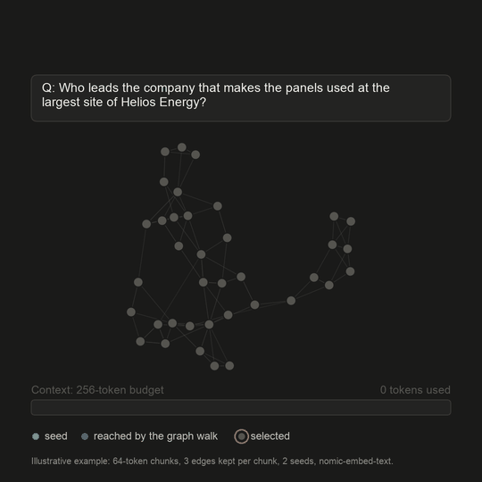

# Architecture

SpectRAG has two pipelines. **Ingestion** (`SpectRAGIngestion`) runs once per document set and
saves an index folder. **Retrieval** (`SpectRAGRetrieval`) loads that folder and runs once per
question.

<figure><figcaption></figcaption></figure>


**Interactive walkthrough:** click through all ten stages on a 12-chunk corpus, inspect any
chunk or edge, and move the selection sliders.


## The problem it solves

Take the question *"Which city is the headquarters of the lab that does the research for
Project Orion?"* Two chunks answer it together:

* **c4**, in the *Project Orion* document: *"The research work for Project Orion is carried out
  by Helix Labs."*
* **c6**, in the *Helix Labs* document: *"Helix Labs is headquartered in Pune."*

c6 never mentions Project Orion. In the walkthrough corpus, dense similarity ranks it 6th of 12,
behind three near-identical *"Project Orion research targets…"* chunks. A top-k retriever with a
70-token budget fits only its first five chunks, so c6 never reaches the LLM.

SpectRAG links c4 and c6 through the entity *Helix Labs*. It reaches c6 by walking the graph,
then prefers it over a fourth Orion chunk because it opens a new document and a new community,
and repeats nothing already chosen.

## Offline: ingestion

```python
SpectRAGIngestion("my_index", settings).ingest("docs/")
```

| Step | What happens | Paper | Module |
|---|---|---|---|
| 1. Load | Read `.txt`, `.md` and `.pdf` files; each file is one document | | `utils/loader.py` |
| 2. Chunk | Split by headings, keeping each chunk's section path, or where the topic changes (90th-percentile sentence distance). At most `chunk_tokens` (1,200) tokens with `overlap_tokens` (100) overlap; sentences and table rows are never cut | Section 3.3 | `utils/chunker.py`, `utils/sections.py`, `utils/semantic_split.py` |
| 3. Annotate | Entities (rule-based, or your `entity_fn`), references to sections and files, and utility questions (with your `question_fn`) | Section 3.2.1 | `utils/entities.py`, `utils/references.py`, `utils/questions.py` |
| 4. Embed | `nomic-embed-text` with the `search_document:` prefix, the offline hash embedder, or your function; vectors are L2-normalised | Table 1 | `utils/embedder.py`, `utils/vector_index.py` |
| 5. Edge signals | Six links between chunks, each in [0, 1] | Section 3.2.1 | `utils/edges*.py` |
| 6. Weighted graph | Weighted sum of the signals; edges below τ dropped; each chunk keeps its `graph_k` strongest edges | Eq. 10 | `utils/graph_build.py` |
| 7. Spectral coordinates | The smallest non-trivial eigenvectors of the normalised Laplacian: 32 numbers per chunk that say *where it sits* in the graph | Eq. 11–13 | `utils/spectral.py` |
| 8. Clusters | k-means on the row-normalised coordinates, for the selector's coverage term | Section 3.4 | `utils/clusters.py` |
| 9. Save | Binary arrays and JSON files, written to `<folder>.partial` and moved into place when complete | Table 1 | `utils/store.py` |

### The six edge signals

| Signal | Links two chunks when they... | Default weight α |
|---|---|---|
| `semantic` | are among each other's `semantic_k` (10) nearest neighbours by embedding (either direction); weight = cosine | 0.300 |
| `section` | are in the same section of a document (1.0), or in sibling or parent and child sections (shared headings ÷ longest path) | 0.250 |
| `entity` | mention the same entities (Jaccard overlap of their entity sets) | 0.200 |
| `adjacency` | are next to each other in the same document | 0.084 |
| `utility` | can answer similar questions (cosine of their utility-question embeddings, k nearest neighbours) | 0.083 |
| `citation` | one refers to the other: a numbered section (*Section 2.1*, *§4*) or another document by file name (*notes.md*) | 0.083 |

The weights are the paper's *signal configuration 1*. A signal with no edges in your corpus
(for example `utility`, when no `question_fn` is given) gives its weight to the others, in
proportion.

$$
w_{ij} = \sum_{r} \alpha_r \, w^{(r)}_{ij}, \qquad \text{keep the edge if } w_{ij} \ge \tau
$$

### Spectral coordinates

From the weight matrix $$W$$ and the degrees $$D$$, the normalised Laplacian is

$$
L_{sym} = I - D^{-1/2} \, W \, D^{-1/2}
$$

Its eigenvectors $$u_2, \dots, u_{33}$$ (the first is trivial) give each chunk a 32-number
coordinate $$z_i$$. Chunks that are strongly linked get similar coordinates, so communities of
the corpus become clusters of points. [The spectral part](spectral.md) explains why.

## Online: retrieval

```python
result = SpectRAGRetrieval("my_index").search(question, token_budget=4000)
```

<figure><figcaption><p>A three-hop question on the 14-document example set: seeds, the two-hop walk, PageRank scores, and the 256-token budget. This example was chosen to show the mechanism (64-token chunks, 3 edges per chunk, 2 seeds); measured results are in <a href="../results/benchmarks.md">Benchmarks</a>.</p></figcaption></figure>

| Step | What happens | Paper | Module |
|---|---|---|---|
| 1. Hybrid seeds | Dense, BM25 and utility-question rankings fused with reciprocal rank fusion → `seed_count` (20) seeds, and a relevance score for every chunk | Table 2 | `utils/seeding.py`, `utils/bm25.py` |
| 2. Graph expansion | Breadth-first search from the seeds, `hops` (2) hops, at most `max_candidates` (200) chunks: this is where bridge evidence enters | Section 3.6 | `utils/expansion.py` |
| 3. Proximity re-scoring | Relevance blended with graph proximity: Personalized PageRank from the seeds and spectral closeness | Eq. 17–18 | `utils/diffusion.py` |
| 4. Token-budget selection | A protected core, a greedy tail that trades relevance against redundancy, coverage and length, then backfill; never over the budget | Eq. 19–22 | `utils/selection.py`, `utils/selectors.py` |
| 5. Context and answer | Selected chunks grouped by document, in a grounded prompt for any LLM | Algorithm 1 | `utils/prompt.py`, `utils/llm.py` |

### Seeds

$$
\mathrm{RRF}(c) = \sum_{\text{lists}} \frac{1}{k + \mathrm{rank}(c)}, \qquad k = 60
$$

The relevance of a chunk is $$(1 - w)\cdot\text{dense} + w\cdot\text{BM25}$$, both scaled to
0…1, with $$w$$ = `bm25_weight` (0.5).

### Re-scoring

Personalized PageRank spreads the seeds' relevance over the candidate subgraph
($$\tilde{A} = D^{-1/2} W D^{-1/2}$$, restart share $$\beta$$ = `ppr_beta`, 0.15):

$$
s^{(t+1)} = \beta \, r + (1-\beta)\, \tilde{A}\, s^{(t)}
$$

The default `proximity_mode = "hybrid"` averages it with spectral closeness to the seeds, then

$$
\text{score}(c) = (1-\alpha)\,\text{relevance}(c) + \alpha\,\text{proximity}(c), \qquad \alpha = 0.3
$$

### Selection

The selector first keeps the `core_size` (3) best-scored chunks. It then repeatedly adds the
chunk with the best utility per token, among chunks above the precision floor:

$$
U(c \mid C) = a\, s_c + b\,\text{Prox}(c) + c\,\text{ClusterGain}(c, C) + d\,\text{DocGain}(c, C) - \lambda\,\text{Red}(c, C)
$$

$$
c^{*} = \arg\max_{c} \frac{U(c \mid C)}{\ell(c)^{\rho}}, \qquad \sum_{c \in C} \ell(c) \le B
$$

* **ClusterGain** and **DocGain** are 1 for a chunk from a spectral cluster (or document) not
  yet in the context, ½ for the second, and so on: they reward coverage.
* **Red** is the highest cosine similarity to a chunk already chosen: it penalises
  near-duplicates.
* $$\ell(c)$$ is the chunk's length in tokens and $$\rho$$ = `length_power` (0.5).

Finally, backfill adds the best remaining chunks that still fit, so no budget is wasted. Other
selectors (`mmr`, `protected_mmr`, `anchor_expand_ce`, `topk`) are described in
[Configuration](../guides/configuration.md#selection).

## Design decisions

The paper leaves some details open: for example the value of $$\rho$$, the edge threshold
$$\tau$$, and how entities are found. Every such choice, and why it was made, is listed in
[DESIGN.md](https://github.com/aion7891/Spect-RAG/blob/main/docs/DESIGN.md) (decisions D1–D64).
