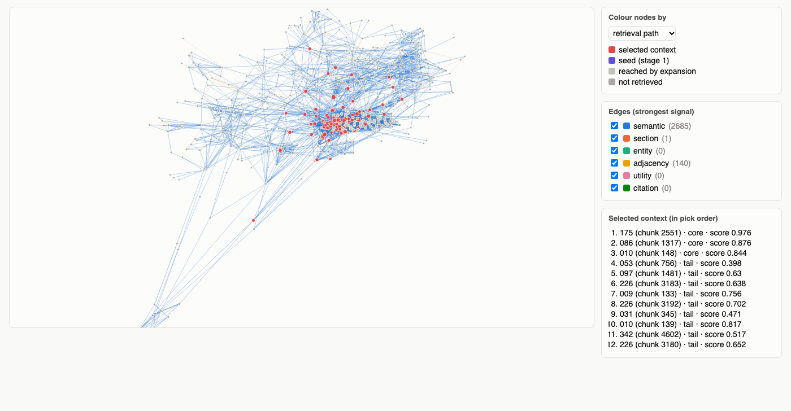

# Graph view

`spectrafuse graph` writes one self-contained HTML file that shows your index as a graph: chunks
are nodes, edges are coloured by their strongest signal, and a question's retrieval path is
highlighted (seeds, chunks reached by the graph walk, and the selected context). It is similar
to Figure 5 of the paper, and needs no internet connection.

<figure markdown="span">
  
  <figcaption markdown="span">600 MultiHopRAG chunks, with the retrieval path of one question.</figcaption>
</figure>

<div class="spectrafuse-embed" markdown>
<iframe src="../../interactive/graph-view.html" title="Graph view example" loading="lazy"></iframe>

**Live example:** the 14-document evaluation set and the question *"Which company acquired the
former employer of the person who leads the Madrid office of Aurora Labs?"* [Open it in a full window](../interactive/graph-view.html).
</div>

## Make one

=== "Command line"

    ```bash
    spectrafuse graph --index my_index --out graph.html
    spectrafuse graph --index my_index --out graph.html --question "Where is Helios Energy based?"
    ```

=== "Python"

    ```python
    from spectrafuse.utils.graph_view import save_graph_view

    save_graph_view("my_index", "graph.html", question="Where is Helios Energy based?")
    ```

Open the file in any browser.

| Option | CLI | Python | Default |
|---|---|---|---|
| index folder | `--index` | `index_dir` | required |
| output file | `--out` | `path` | `graph.html` |
| question to trace | `--question` | `question` | none |
| retrieval settings for that question | `--set key=value` | `settings` | the index's settings |
| largest number of nodes drawn | `--max-nodes` | `max_nodes` | 1500 |

## What you see

* **Layout:** each chunk starts at its spectral coordinates $(u_2, u_3)$, then a short force
  layout pulls linked chunks together and pushes the others apart.
* **Edge colours:** the signal that contributed most to the edge's weight (semantic, section,
  entity, adjacency, utility or citation).
* **Retrieval path:** seeds, chunks reached by graph expansion, and the chunks selected for the
  context, with their rank, score and the reason they were picked.

**Interaction:** hover a node to read its text, click it to highlight its neighbours, scroll to
zoom, drag to pan, and use the checkboxes to hide signals.

## Large indexes

When the index has more chunks than `max_nodes`, the view keeps the retrieval path, then grows
outwards from it (neighbours, then their neighbours), then adds the best-connected chunks. Lower
`--max-nodes` if the page feels slow in your browser.

## Use the data yourself

`graph_data()` returns everything the page draws, as plain Python data, for your own
visualisation:

```python
from spectrafuse.utils.graph_view import graph_data

data = graph_data("my_index", question="Where is Helios Energy based?")
data["nodes"][0]     # {"id", "x", "y", "doc", "section", "cluster", "position", "degree", "state", "text"}
data["edges"][0]     # [i, j, weight, strongest signal]
data["picked"]       # the selected chunks: id, rank, reason, doc, score
```
