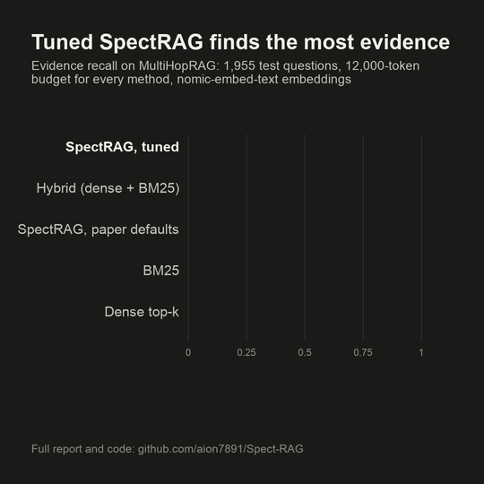

# Benchmarks

All numbers on this page come from runs committed to the repository: the JSON results and
[the full report](https://github.com/aion7891/Spect-RAG/blob/main/benchmarks/results/multihoprag/REPORT.md)
are in `benchmarks/results/multihoprag/`. A re-run of all 1,955 test questions reproduces them
with 0 differences.

<figure><figcaption></figcaption></figure>

## Setup

| | |
|---|---|
| Dataset | [MultiHopRAG](https://arxiv.org/abs/2401.15391): 609 news articles, multi-hop questions with gold evidence |
| Questions | 300 for tuning only (validation); **1,955 for every reported number** (test) |
| Index | 1,200-token chunks → 7,807 chunks, 56,390 graph edges |
| Embeddings | `nomic-embed-text` through Ollama, the same for every method |
| Budget | **12,000 tokens of context for every method** |
| Main metric | **evidence recall**: the share of gold evidence passages that end up in the context |

## Retrieval results

| Method | Recall@5 | Recall@10 | Evidence recall | All evidence found | MRR | ms / query |
|---|---|---|---|---|---|---|
| Standard RAG (dense top-k) | 0.355 | 0.483 | 0.758 | 0.512 | 0.507 | 1.3 |
| BM25 | 0.462 | 0.577 | 0.788 | 0.545 | 0.617 | 1.0 |
| Dense + MMR | 0.359 | 0.482 | 0.756 | 0.507 | 0.508 | 1.3 |
| Hybrid RAG (dense + BM25, RRF) | 0.445 | 0.574 | 0.832 | 0.615 | 0.609 | 2.8 |
| SpectRAG, default settings | 0.385 | 0.433 | 0.803 | 0.550 | 0.592 | 4.4 |
| **SpectRAG, tuned on validation** | **0.470** | **0.592** | **0.846** | **0.639** | **0.617** | 3.5 |

*All evidence found* is the share of questions with every evidence passage in the context: a
multi-hop question usually needs all of them. Latency is the median on an idle machine, not
counting the 19 ms to embed the question (the same for every method).

<figure><figcaption><p>Recall@2, @5 and @10.</p></figcaption></figure>

<figure><figcaption><p>Evidence recall and all evidence found within the budget.</p></figcaption></figure>

Paired bootstrap differences (95% confidence intervals):

| Comparison | Evidence recall | Recall@10 |
|---|---|---|
| SpectRAG tuned − hybrid | **+0.014** (+0.007 … +0.021) | +0.017 (+0.009 … +0.025) |
| SpectRAG tuned − standard RAG | +0.088 (+0.076 … +0.099) | +0.109 (+0.096 … +0.122) |
| SpectRAG default − hybrid | −0.029 (−0.040 … −0.018) | −0.142 (−0.153 … −0.130) |
| SpectRAG default − standard RAG | +0.044 (+0.032 … +0.057) | −0.050 (−0.063 … −0.037) |

## By question type

Evidence recall within the budget:

| Method | Comparison | Inference | Temporal |
|---|---|---|---|
| SpectRAG, tuned | 0.902 | **0.802** | **0.826** |
| Hybrid RAG | **0.911** | 0.757 | 0.820 |
| SpectRAG, default | 0.852 | 0.746 | 0.809 |
| BM25 | 0.864 | 0.720 | 0.771 |
| Standard RAG | 0.843 | 0.637 | 0.804 |

Tuned SpectRAG gains most on **inference** questions, which need facts from several articles
(+0.045 over hybrid). On **comparison** questions hybrid retrieval stays slightly ahead
(−0.009), as in the paper.

## Ablations

Changing one part of SpectRAG at a time (other settings at their defaults):

| Variant | Evidence recall | Recall@10 |
|---|---|---|
| SpectRAG, default | 0.803 | 0.433 |
| `length_power = 0` | 0.820 | 0.580 |
| `selector = "topk"` | 0.845 | 0.579 |
| `selector = "mmr"` | 0.845 | 0.595 |
| `selector = "protected_mmr"` | 0.845 | 0.595 |
| `selector = "anchor_expand_ce"` (no cross-encoder) | 0.809 | 0.530 |
| no proximity re-scoring | 0.808 | 0.449 |
| heat-kernel proximity | 0.732 | 0.382 |
| **no graph expansion** | **0.705** | 0.492 |

* **The graph walk carries most of the gain.** Without expansion, evidence recall drops from
  0.803 to 0.705 (this also shrinks the candidate pool).
* **The heat kernel did worse than the default** PageRank + spectral mix on this dataset.

### What the defaults get wrong

The paper's greedy selector divides each chunk's utility by its length to the power ρ. The paper
gives no value for ρ; the default guess `length_power = 0.5` favours very short chunks. The
default run picked 85 chunks per question where other methods picked about 47, and its
Recall@10 fell to 0.433. The other selectors, on the same graph-re-scored candidates, reach 0.845
evidence recall without any tuning.


Version 0.1.0 keeps the paper-based defaults. Better defaults are planned for a later version.
Until then, use `selector = "protected_mmr"` or [tune on your own questions](../guides/tuning.md).


## Smaller experiments

| Experiment | Result |
|---|---|
| HyDE (60 test questions) | evidence recall 0.760, against 0.807 for dense and 0.825 for SpectRAG default on the same sample |
| Answers with `gemma3:4b` (30 questions, 10 per type) | exact match: tuned SpectRAG 0.400, default 0.367, dense 0.333, hybrid 0.267. One answer is 0.033, so these differences are small |
| LightRAG (4-article subset) | **inconclusive.** The local LLM needed about 225 s per article to build LightRAG's graph, so only 4 articles were indexed. That subset (6,805 tokens) fits in the budget, so every method scores 1.0. No claim is made against LightRAG |

## Limits of this run

* **Quick mode.** One chunk size (1,200 tokens) and 30 tuning trials. To ingest about 60 times
  faster, quick mode finds semantic-chunking breaks with the hash embedder (sentence distances
  only); chunks and questions are embedded with `nomic-embed-text`. Full mode
  (`SPECTRAG_BENCH_FULL=1`: a second chunk size, 120 trials, nomic for chunking too) was not run.
* **One dataset.** The tuned settings were tuned on news articles; they may not carry over.
* **One machine.** Latency and memory were measured on an Apple Silicon Mac.

## Reproduce it

From a clone, with Ollama running and `ollama pull nomic-embed-text` and `ollama pull gemma3:4b` done:

```bash
python benchmarks/multihoprag_benchmark.py      # index, tune, evaluate, latency (embedding takes most of the time)
python benchmarks/mhr_llm_steps.py hyde          # HyDE; "answers" for the answer test
python benchmarks/mhr_report.py                 # REPORT.md and the charts
python benchmarks/ann_benchmark.py              # exact vs FAISS vs HNSW
```

The dataset (ODC-BY licence) is stored in `benchmarks/data/multihoprag/` with checksums.
